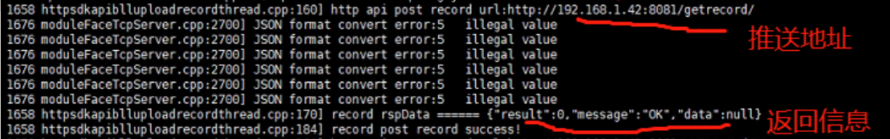
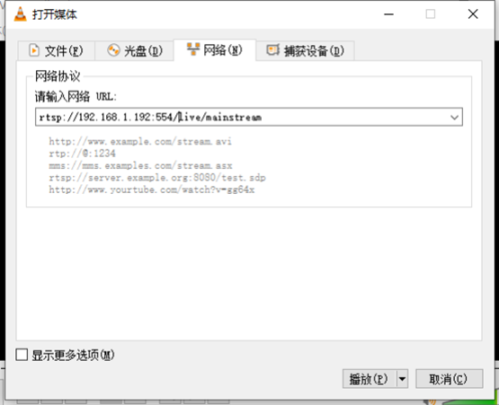

# 06 设备对接协议（局域网 HTTP）

| 项目 | 内容 |
|---|---|
| 本文性质 | **厂商协议整理稿**，供我方对接调试使用，不是业务需求文档 |
| 原文标题 | 局域网http对接协议（RV1109 系列人脸识别门禁终端 · 标准版固件） |
| 原文链接 | <https://docs.qq.com/doc/DWG1lZWF4V1BudWVO> |
| 整理日期 | 2026-11-16 |
| 整理方式 | 从腾讯文档在线正文按原文顺序抽取文字、表格与代码示例；原文界面截图已下载至 `assets/06-lan-http/` |
| 适用于本项目的部分 | 大门出入口两台终端与访客平台的**内网直连**对接（不经厂商云）；本次测试机为 **YC-P208**（SN `T77R781116ZS`），MAC 段 `0A:0C:xx` 与协议示例一致 |
| 关联文档 | [01 业务需求说明书](./01-业务需求说明书.md) · [04 W0 现场验证清单](./04-W0现场验证清单.md) · [07 RV1109 云对接协议](./07-设备对接协议-RV1109云对接.md) · [08 设备联调与心跳配置指南](./08-设备联调与心跳配置指南.md) |

> **抽取说明**
> 1. 文字、参数表、请求/响应示例均取自原文，未改写；原文中的界面截图已下载并在原位引用。
> 2. 原文小节编号本身存在重复（如两个 2.2.3、两个 2.2.7），此处保持原样，检索接口请以 `Url 地址` 为准。
> 3. 原文个别“示例”块与所在小节对不上（例如 3.0 在线比对识别末尾的示例实为网络配置示例），以接口参数说明为准。
> 4. 示例中的 IP（192.168.1.135）与密码（123456）为原文示例值，现场以设备实际值为准。

## 0. 对接要点速查（我方补充，非原文）

### 0.1 设备侧基础约定

| 项目 | 原文取值 |
|---|---|
| 传输协议 | HTTP，`http://<ip>:8091/<URL>`，UTF-8，POST + JSON body |
| 默认端口 | 8091 |
| 默认密码 | 123456（每条请求 body 内带 `password` 字段做校验） |
| 返回约定 | `result: 0` 成功；`1` 参数设置错误；`2` 密码错误 |
| 登录 | 先调 `/deviceLogin`，之后各接口仍以 body 内 `password` 校验 |
| 心跳 | ① 设备主动上报：`setDeviceParameter` 里配 `heartBeatEnable` + `heartBeatIp`，间隔 30 秒；② 平台主动查询：`/heartBeat` |

### 0.2 与本期业务规则相关的接口

| 业务动作 | 对应业务规则 | 接口 | 备注 |
|---|---|---|---|
| 绑定设备、确认在线 | — | `POST /deviceLogin`、`/heartBeat`、`/getDeviceParameter` | 心跳 30 秒一次，含 `personCount`、`SN` |
| 配置心跳地址（现场第一步） | — | `POST /setDeviceParameter`（`heartBeatEnable`、`heartBeatIp`） | 设备 → 平台 |
| 区分入口/出口设备 | BR-V-026 | `setDeviceParameter.inout`（0 出口 / 1 入口） | 方向由设备自身决定，平台不推断 |
| 人证 + 白名单核验 | BR-V-001、W0 V1 | `setDeviceParameter.recogModeID`：1 人证比对、2 人证 + 白名单、3 仅刷身份证、4 验证身份证（按证件号查白名单） | 选 4 即可证明“白名单按证件号命中”，无需访客人脸 |
| 在线比对（平台实时判权） | BR-V-018~024、W0 V2/V4 | `setDeviceParameter.Comparison=1` + `comparisonAddress`，或“在线比对识别”协议（`type=qr` / `type=id`） | 动态二维码只能走在线比对 |
| 审批通过后下发通行名单 | BR-V-005、BR-V-007、BR-V-008 | `POST /addDeviceWhiteList`（`passAlgo: true` 表示不需要照片） | 有效期用 `peoplestartdate` / `peopleenddate` |
| 撤销授权 / 离场后失效 | BR-V-015 | `POST /deleteDeviceWhiteList`、`/deleteDeviceAllWhiteList` | 离线设备恢复联网后失效 |
| 查询设备名单与容量 | BR-E-010 | `POST /getAllDeviceIdWhiteList`、`/getDeviceWhiteListDetailByIdNum` | 用于容量水位监控 |
| 通行记录上报（进出留痕） | BR-V-009、BR-V-012、BR-V-025、BR-V-027 | `POST /setIdentifyCallBck`（`platformEnable` + `platformIp`），设备推送记录后必须回 `{"message":"ok","result":0}` | 支持断网续传；记录含 `inout`、`IdentifyType`、`resultStatus`、`face_base64` |
| 补推历史记录 | BR-V-011、BR-D-007 | `POST /setDeviceRecordRevert` | 按时间段重新推送 |
| 保安人工开门 | BR-V-003、BR-D-011 | `POST /setDeviceRemoteOpen` | 员工刷脸失败时的兜底 |
| 屏幕提示（如“设备离线”） | BR-V-014 | `POST /setDeviceShowMessage` | 断网提示 |
| 设备校时 | BR-V-016、BR-V-026 | `POST /setDeviceTime`、`/getDeviceTime` | 时间错乱会导致去重与方向判定异常 |
| 抓拍取证 | BR-V-012、BR-D-006 | `POST /getDeviceSnapPicture`、`/getDeviceSnapFace` | 失败核验留痕 |
| 设备维护 | W0 V3 | `/getDeviceVersion`、`/setDeviceReboot`、`/getDeviceLog`、`/uploadUpgradeAPKFile` | 固件版本直接影响人员有效期是否生效 |
| 数据传输加密 | BR-D-008 | `/SetCheckCode`、`/GetCheckCode` | 可选，启用后请求需带校验码 |

### 0.3 调试时最容易踩的六个坑（前三条为原文推得，后四条为真机实测）

1. **日期格式**：名单有效期必须 `yyyy-MM-dd`，且日期后带一个空格，否则设备可能解析失败（见 W0 V3）。
2. **`platformEnable` 语义不一致**：`setIdentifyCallBck` 中 `platformEnable=0` 为**开**，而 `setDeviceParameter` 中 `platformEnable=1` 为开。
3. **识别记录回调地址必须是平台自己起的 HTTP 服务**，端口要放行；否则设备会一直重推同一条记录（记录支持断网续传）。
4. **`intranetSetting`（内外网模式）在 C978GH 机型上无效**：设备界面注明「仅适用于 702K，修改后重启生效」，实测下发 `intranetSetting=1` 后厂商云登录依旧每 20 秒一次（2026-11-16，日志 265 次）。**不能用它切换内外网**，通道应由平台侧设备档案决定。
5. **`Comparison=1` 且 `comparisonAddress` 指向厂商云时，无外网会导致刷卡/刷脸静默失败**（无任何屏幕提示，只有日志里 `Post HttpApi_OnlineComparison failure`）。调试初期应先置 `Comparison=0`（离线比对）。
6. **`usertype=visitor` 在 YC-P208 上返回「添加成功」但不落库**：`addDeviceWhiteList` 用 `visitor` 时 `getAllDeviceIdWhiteList` 查不到；改用 `white` 后立刻可见。平台侧默认按 `white` 下发访客（配置项 `fangke.device.visitor-user-type`），换设备后需重新验证该取值。

---

## 原文（按原文顺序整理，未改写）

局域网http对接协议

说明：此文档适用于标准版本，定制版本差异请咨询技术人员

### 更新日志

| 更新日期 | 更新说明 | 备注 |
|---|---|---|
| 2020-08 | 首发版本 |   |
| 2021-04-12 | 1、 增加时间段支持<br>2、 增加设备照片检验接口<br>3、增加了重提记录的接口 |   |
| 2021-05-10 | 1、 新增人证比对模式 仅刷身份证和验证身份证<br>2、 增加记录上传中的模板照片 |   |
| 2021-05-13 | 1、增加设备提示文字 |   |
| 2021-05-13 | 增加RTSP视频流切换功能 |   |
| 2021-05-24 | 增加不需要照片录入名单功能 |   |
| 2021-06-23 | 补充获取视频流方法 |   |
| 2021-07-08 | 增加设备数据传输加密接口 |   |
| 2021-08-09 | 增加健康码数据推送 |   |
| 2021-11-24 | 增加了韦根类型等参数 |   |
| 2021-12-07 | 修改时间组设置方式（不影响原来的设置方式） |   |
| 2022-03-24 | 增加设置UI接口 |   |
| 2023-02-20 | 增加抓拍设备人脸照片<br>（可用于添加白名单） |   |
| 2023-03-20 | 增加一人多卡参数、添加部分设备参数 |   |
| 2023-12-26 | 增加获取网络参数接口 |   |
| 2024-09-26 | 获取设备参数接口增加经纬度 |   |

### 1 设备协议概述

#### 1.1 简述

该文档是我司基于人脸识别设备端的开放协议，主要提供给需要使用HTTP协议对接设备的客户，支持局域网内的http协议开发。接口主要包括人员管理、照片管理、设备信息配置、记录上传等相关的核心业务。

#### 1.2 接口规范

协议类型：使用标准HTTP协议，Content类型可以包含Json数据和二进制数据，具体参照相关协议，请务必严格按照提供的接口参数和类型填写。

接口地址：http://<ip>:8091/<URL>

接口安全：初次调用接口需要先使用用户和密码登录，后续调用任何接口都需要传入密码作为接口安全校验秘钥。

格式说明：数据通信的时候可能会涉及到中文字符，统一采用的是utf-8格式，使用post传输参数时，将参数采用json格式放到body中。

#### 1.3 接口说明

默认启动端口号为8091端口 ；密码默认为 123456

### 2 协议接口定义

#### 2.1 登录和心跳消息

##### 2.1.1 登录设备

Url 地址：http://deviceAddress:port/deviceLogin

请求方式：post

发送消息的内容

| 数据类型 | 字段名称 | 说明 |
|---|---|---|
| String | password | 用户密码 默认123456 |

接受消息应答数据内容

| 数据类型 | 字段名称 | 说明 |
|---|---|---|
| String | message | 提示消息 |
| int | result | 0 成功; |

**示例**

```
url：http://192.168.1.135:8091/deviceLogin

发送：
{"password":"123456"}

返回：
{
    "message": "Login   Success",
    "result": 0
}
```

##### 2.1.2 心跳消息

方法一：由用户【设置设备参数】设置的heartBeatIp地址，设备主动上传心跳信息。

支持post 方法

具体查看设备参数

接口地址 http://deviceAddress:port/setDeviceParameter

（接口地址是配置设备参数接口）

发送消息的内容

| 数据类型 | 字段名称 | 说明 |
|---|---|---|
| String | password | 设备用户密码 |
| Object | data | 表示当前消息体的数据 |

Data消息体的内容

| 数据类型 | 字段名称 | 说明 |
|---|---|---|
| int | heartBeatEnable | 0开 1关 |
| String | heartBeatIp | 心跳地址 |

接受消息应答数据内容

| 数据类型 | 字段名称 | 说明 |
|---|---|---|
| String | message | 提示消息 |
| int | result | 0 成功; 1,参数设置错误；2,密码错误； |

配置后设备的心跳请求如下：（心跳间隔30S）

设备发送消息的内容

| 数据类型 | 字段名称 | 说明 |
|---|---|---|
| String | currentTime | 时间 |
| String | ip | 设备的ip地址 |
| int | personCount | 人脸数 |
| String | SN | 设备sn |

接受消息应答数据内容

| 数据类型 | 字段名称 | 说明 |
|---|---|---|
| String | message | 提示消息 |
| int | result | 0 成功; 非0 异常 |

方法二：主动请求设备心跳

Url 地址：http://deviceAddress:port/heartBeat

请求方式：post

发送消息的内容

| 数据类型 | 字段名称 | 说明 |
|---|---|---|
| String | password | 用户密码 默认123456 |
| String | ip | 设备的ip地址 |

接受消息应答数据内容

| 数据类型 | 字段名称 | 说明 |
|---|---|---|
| String | message | 提示消息 |
| int | result | 0 成功; 1,参数设置错误；2,密码错误； |

**示例**

```
url：http://192.168.1.135:8091/heartBeat

发送：
{"password":"123456","ip":"192.168.1.135"}

返回：
{"message" :"HeartBeat Success","result" : 0}
```

#### 2.2 设备运行信息

##### 2.2.1 获取设备参数

Url 地址：http://deviceAddress:port/getDeviceParameter

请求方式：post

发送消息的内容

| 数据类型 | 字段名称 | 说明 |
|---|---|---|
| String | password | 用户密码 |

接受消息应答数据内容

| 数据类型 | 字段名称 | 说明 |
|---|---|---|
| String | message | 提示消息 |
| int | result | 0 成功; 1,参数设置错误；2,密码错误； |
| Object | data | 表示当前消息体的数据 |

设置参数的data消息体的内容：

（data中有健康码设置参数，不用管此参数）

| 数据类型 | 字段名称 | 说明 |
|---|---|---|
| String | devicename | 名称 |
| String | Mac_addr | 设备唯一mac地址 |
| String | SN | 设备唯一序列号 |
| String | location | 位置 |
| int | inout | 出入 0出口 1入口 |
| String | pwd | 密码 6位数字 |
| int | whitevalue | 人脸识别阈值 [70,100] |
| int | mapvalue | 人证识别阈值 [30,100] |
| int | recogSpaceTime | 识别去重时间（秒）[2,255] |
| int | delayvalue | 开门延迟 秒（默认1S） |
| int | lightLevelPercent | 补光灯亮度 0-100 |
| int | lightType | 0 常关 1 常开 2 按时间段开启 3自动补光（自动补光规则：检测到人脸即亮、无人脸立即关闭，当摄像头透光量低时常开补光灯） |
| String | lightTimeStart | 补光灯开启时间 |
| String | lightTimeEnd | 补光灯关闭时间 |
| int | systemVol | 系统音量 [0,7] |
| int | detectRange | 识别距离 [0,3] [无限制,0.5米,1米,2米] |
| int | wgOutType | 韦根输出类型 0.韦根26 1.韦根34 |
| int | wgInOutMode | 韦根模式 0韦根输出，1 韦根输入 |
| int | livenessEnable | 活体开关 0开启 1关闭 |
| int | InfraredImaging | 黑白成像视频 0开启 1关闭 |
| int | livenessValue | 活体分数 0-10 |
| int | recogModeDB | 人脸识别 0禁用，1开启，2健康码白名单（不开启健康码时此功能就是人脸识别） |
| int | recogModeIC | 识别模式 0禁用 1 IC卡识别<br>2 IC卡加人脸识别 |
| int | recogModeID | 识别模式 0 禁用 1人证识别 （身份证照片+人脸照片比对） 2 人证+白名单验证（人证比对后检验人脸在百名单库） 3 仅刷身份证<br>4 验证身份证 （刷了身份证后验证身份证号码在白名单库中） |
| int | detectVoiceEnable | 陌生人识别 0禁用，1抓拍识别，<br>2 抓拍识别并开门 |
| int | recogRelay | 识别开门 0继电器不输出 1继电器输出<br>（设置继电器不输出后需调用接口开闸http://deviceAddress:port/setDeviceRemoteOpen ） |
| String | rebootTime | 自动重启间隔 "DDHHmm"<br>DD说明：00 每天，01周一，02周二，03周三，04周四，05周五，06周六，07周日 |
| int | TemperatureMode | 测温功能 0 不测温 1 测温+人脸识别 2 只测温 |
| String | TempNormalMax | 测温报警温度（默认37.2） |
| int | TempThermography | 测温热成像视频 0 关闭 1 开启 |
| int | OutSideDetectMode | 测温使用环境 0:标准模式 1:户外模式 |
| int | EnableMasks | 口罩检测 0 关闭 1 开启 |
| int | IntelligentRecognition | 安全帽识别 0 关闭 1 开启 |
| int | wgOutType | 韦根输出类型 0-韦根26， 1-韦根34 |
| int | wgInOutMode | 韦根模式 0韦根输出 1韦根输入 |
| int | relayMode | 继电器类型 0:标准模式 、1:持续开门，2:持续关门 |
| String | banner | 设备标语（默认值为人脸识别门禁终端）（说明：修改此值需要开启 bannerEnable参数） |
| int | bannerEnable | 待机屏保 0 关 1 打开 |
| int | bannerSpaceTime | 待机屏保图片切换时间 |
| int | VideoSwitch | RTSP视频流切换 0 RGB视频流， 1 IR视频 |
| int | voiceSetting | 自定义语音功能 0禁用，1启用 （语音模块接串口2） |
| String | customVoice | 自定义语音内容 |
| int | resultDisplayMode | 识别结果显示 0禁用，1启用 |
| String | resultCustomization | 识别结果显示内容（自定义显示识别结果） |
| int | passwordOpendoor | 密码开门功能 0禁用，1启用 |
| String | doorPassword | 开门密码（6位纯数字） |
| int | Comparison | 比对模式 0离线比对 1在线比对 |
| String | comparisonAddress | 在线比对地址 |
| int | longitude | 经度 （仅支持获取，不支持设置） |
| int | latitude | 纬度（仅支持获取，不支持设置） |
| int | backlightType | 显示屏控制模式 0 常亮 2自动息屏 |

**示例**

```
url：http://192.168.1.135:8091/getDeviceParameter

发送：
{"password":"123456"}

返回：
{
    "data" :
    {
        "CheckTempWorkMode" : 0,
        "EnableMasks" : 0,
        "EnableNonResidentTemp" : 1,
        "platformEnable" : 0,
        "platformIp" :   "http://192.168.1.198:8080/getrecord/",
        "pwd" : "123456",
        "rebootTime" :   "000000",
        "recogModeDB" : 1,
        "recogModeIC" : 0,
        "recogModeID" : 1,
        "recogRelay" : 0,
        "recogSpaceTime" : 3,
        "relayMode" : 0,
        "resultFormat" :   "",
        "resultNameEncrypt" : 0,
        "resultSetting" : 0,
        "resultVoiceFormat" :   "",
        "systemVol" : 7,
        "upblack" : 1,
        "uploadImage" : 1,
        "voiceSetting" : 2,
        "wgOutType" : 0,
        "whitevalue" : 80
    },
    "message" : "Get Device   Parameter Success",
    "result" : 0
}
```

##### 2.2.2 设置设备参数

Url 地址：http://deviceAddress:port/setDeviceParameter

请求方式：post

发送消息的内容

| 数据类型 | 字段名称 | 说明 |
|---|---|---|
| String | password | 设备用户密码 |
| Object | data | 表示当前消息体的数据 |

消息内容的结构见【获取设备参数】消息体的内容

接受消息应答数据内容

| 数据类型 | 字段名称 | 说明 |
|---|---|---|
| String | message | 提示消息 |
| int | result | 0 成功; 1,参数设置错误；2,密码错误； |

**示例**

```
url：http://192.168.1.135:8091/setDeviceParameter

发送：
{"password":"123456","data":{"name":"test","location":"test"}}

返回：
{"message":"Set Device Parameter Success","result" : 0}
```

##### 2.2.3 设备升级

Url 地址：http://deviceAddress:port/uploadUpgradeAPKFile

支持post 以表单方式的方式上传

发送消息的内容

| 数据类型 | 字段名称 | 说明 |
|---|---|---|
| String | password | 设备用户密码 |

接受消息应答数据内容

| 数据类型 | 字段名称 | 说明 |
|---|---|---|
| String | message | 提示消息 |
| int | result | 0 成功; 1,参数设置错误；2,密码错误； |

| 注意：<br>1), Headers,Content-Type 类型为multipart/form-data；<br>2), Params,需要携带password<br>3), Body 选择需要升级.img文件，文件只能从低版本升级到高版本； |
|---|

##### 2.2.3 设备重启

Url 地址：http://deviceAddress:port/setDeviceReboot

请求方式：post

发送消息的内容

| 数据类型 | 字段名称 | 说明 |
|---|---|---|
| String | password | 设备用户密码 |
| Object | data | 消息体 |

消息体的内容

| 数据类型 | 字段名称 | 说明 |
|---|---|---|
| String | type | 类型为：<br>DelayReboot 延时重启 |
| int | value | 指定当前在多少秒后重启 |

接受消息应答数据内容

| 数据类型 | 字段名称 | 说明 |
|---|---|---|
| String | message | 提示消息 |
| String | result | 0 成功; 1,参数设置错误；2,密码错误； |

**示例**

```
url：http://192.168.1.135:8091/setDeviceReboot

发送：
{"password":"123456","data":{"type":"DelayReboot","value":"5"}}

返回：
{"message" : "Set Device   Reboot Success","result" : 0}
```

##### 2.2.4 设备控制开闸

Url 地址：http://deviceAddress:port/setDeviceRemoteOpen

请求方式：post

发送消息的内容

| 数据类型 | 字段名称 | 说明 |
|---|---|---|
| String | password | 设备用户密码 |

接受消息应答数据内容

| 数据类型 | 字段名称 | 说明 |
|---|---|---|
| String | message | 提示消息 |
| int | result | 0 成功; 1,参数设置错误；2,密码错误； |

**示例**

```
url：http://192.168.1.135:8091/setDeviceRemoteOpen

发送：
{"password":"123456"}

返回：
{"message" : "Set Device   Remote Open Success","result" : 0}
```

##### 2.2.5 获取版本信息

Url 地址：http://deviceAddress:port/getDeviceVersion

请求方式：post

发送消息的内容

| 数据类型 | 字段名称 | 说明 |
|---|---|---|
| String | password | 设备用户密码 |

接受消息应答数据内容

| 数据类型 | 字段名称 | 说明 |
|---|---|---|
| String | message | 提示消息 |
| int | result | 0 成功; 1,参数设置错误；2,密码错误； |
| Object | data | 消息体 |

消息体的内容

| 数据类型 | 字段名称 | 说明 |
|---|---|---|
| String | device_name | 设备名称 |
| String | firmware_version | 软件版本 |
| String | sysvertime | 编译时间 |
| String | model | 型号 |
| String | macaddr | MAC地址 |
| String | SN | SN |

**示例**

```
url：http://192.168.1.135:8091/getDeviceVersion

发送：
{"password":"123456"}

返回：
{
    "data": {
        "device_name": "Terminal",
        "firmware_version": "101.10193.0000 Build-202100607",
        "macaddr": "DA:8B:11:17:23:3B",
        "model": "C108LD",
        "sysvertime": "20210608-093539"
    },
    "message": "Get Device Version Success",
    "result": 0
}
```

##### 2.2.6 获取相机当前图片

Url 地址：http://deviceAddress:port/getDeviceSnapPicture

请求方式：post

发送消息的内容

| 数据类型 | 字段名称 | 说明 |
|---|---|---|
| String | password | 设备用户密码 |

接受消息应答数据内容

| 数据类型 | 字段名称 | 说明 |
|---|---|---|
| String | message | 提示消息 |
| int | result | 0 成功; 1,参数设置错误；2,密码错误； |
| Object | data | 消息体 |

消息体的内容

| 数据类型 | 字段名称 | 说明 |
|---|---|---|
| String | snapPicBase64 | 相机获取的base64图片数据 |

**示例**

```
url：http://192.168.1.135:8091/getDeviceSnapPicture

发送：
{"password":"123456"}

返回：
{"data":{\n\t\"snapPicBase64":"/9j/4AAQSkZ…………………vOO5waXgEEdM9R1osWhFxuXn+IAntipmh44qIADgjJ7jOasRy444pNaCP/Z"},"message":"Get Device SnapPicture Success","result":0}
```

##### 2.2.7 获取相机当前人脸照片

Url 地址：http://deviceAddress:port/getDeviceSnapFace

请求方式：post

说明：此接口用于抓拍相机当前的人脸照片，与2.2.6的不同点是2.2.6接口请求后直接抓拍当前的照片，2.2.7接口会检测到人脸后再进行抓拍

发送消息的内容

| 数据类型 | 字段名称 | 说明 |
|---|---|---|
| String | password | 设备用户密码 |

接受消息应答数据内容

| 数据类型 | 字段名称 | 说明 |
|---|---|---|
| String | message | 提示消息 |
| int | result | 0 成功; 1,参数设置错误；2,密码错误； |
| Object | data | 消息体 |

消息体的内容

| 数据类型 | 字段名称 | 说明 |
|---|---|---|
| String | snapPicBase64 | 相机获取的base64图片数据 |

**示例**

```
url：http://192.168.1.135:8091/getDeviceSnapFace

发送：
{"password":"123456"}

返回：
{"data":{\n\t\"snapPicBase64":"/9j/4AAQSkZ…………………vOO5waXgEEdM9R1osWhFxuXn+IAntipmh44qIADgjJ7jOasRy444pNaCP/Z"},"message":"Get Device SnapPicture Success","result":0}
```

##### 2.2.7 设置设备logo图片

Url 地址：http://deviceAddress:port/setDeviceLogo

支持post 表单方法上传文件

发送消息的内容

| 数据类型 | 字段名称 | 说明 |
|---|---|---|
| String | password | 设备用户密码 |

接受消息应答数据内容

| 数据类型 | 字段名称 | 说明 |
|---|---|---|
| String | message | 提示消息 |
| int | result | 0 成功; 1,参数设置错误；2,密码错误； |

| 注意：<br>1), Headers,Content-Type 类型为multipart/form-data；<br>2), Params,需要携带password<br>3), Body 选择需要设置的图片文件 |
|---|

##### 2.2.8 恢复默认设备logo图片

Url 地址：http://deviceAddress:port/restoreDeviceLogo

请求方式：post

发送消息的内容

| 数据类型 | 字段名称 | 说明 |
|---|---|---|
| String | password | 设备用户密码 |

接受消息应答数据内容

| 数据类型 | 字段名称 | 说明 |
|---|---|---|
| String | message | 提示消息 |
| int | result | 0 成功; 1,参数设置错误；2,密码错误； |

**示例**

```
url：http://192.168.1.135:8091/restoreDeviceLogo

发送：
{"password":"123456"}

返回：
{"message":"Restore device default logo.","result":0}
```

##### 2.2.9 设置设备的网络地址

Url 地址：http://deviceAddress:port/setDeviceNetwork

请求方式：post

发送消息的内容

| 数据类型 | 字段名称 | 说明 |
|---|---|---|
| String | password | 设备用户密码 |
| Object | data | 消息体 |

消息体的内容

| 数据类型 | 字段名称 | 说明 |
|---|---|---|
| boolean | isDhcp | 是否启动dhcp动态ip |
| String | ip | 静态ip地址 |
| String | gateway | 默认网关 |
| String | mask | 子网掩码 |
| String | dns | dns |

接受消息应答数据内容

| 数据类型 | 字段名称 | 说明 |
|---|---|---|
| String | message | 提示消息 |
| int | result | 0 成功; 1,参数设置错误；2,密码错误； |

**示例**

```
url：http://192.168.1.135:8091/setDeviceNetwork

发送：
{"password":"123456","data":{"isDhcp":false,"ip":"192.168.1.136","gateway":"192.168.1.1","mask":"255.255.255.0","dns":"8.8.8.8"}}

返回：
{"message":"","result":0}
```

##### 2.2.10 恢复设备所有参数配置

Url 地址：http://deviceAddress:port/restoreDeviceDefaultParameter

请求方式：post

发送消息的内容

| 数据类型 | 字段名称 | 说明 |
|---|---|---|
| String | password | 设备用户密码 |

接受消息应答数据内容

| 数据类型 | 字段名称 | 说明 |
|---|---|---|
| String | message | 提示消息 |
| int | result | 0 成功; 1,参数设置错误；2,密码错误； |

**示例**

```
url：http://192.168.1.135:8091/restoreDeviceDefaultParameter

发送：
{"password":"123456"}

返回：
{"message" :"Restore Device Default Parameter Success","result" : 0}
```

##### 2.2.12 获取设备时间

Url 地址：http://deviceAddress:port/getDeviceTime

请求方式：post

发送消息的内容

| 数据类型 | 字段名称 | 说明 |
|---|---|---|
| String | password | 设备用户密码 |

接受消息应答数据内容

| 数据类型 | 字段名称 | 说明 |
|---|---|---|
| String | message | 提示消息 |
| int | result | 0 成功; 1,参数设置错误；2,密码错误； |
| Object | data | 消息体 |

消息体的内容

| 数据类型 | 字段名称 | 说明 |
|---|---|---|
| string | time | 时间 |

**示例**

```
url：http://192.168.1.135:8091/getDeviceTime

发送：
{"password":"123456"}

返回：
{"data" : "{\n\t\"time\" : \"2020-12-16 15:05:07\"\n}","message" : "Get Device Time Success","result" : 0}
```

##### 2.2.13 设置设备时间

Url 地址：http://deviceAddress:port /setDeviceTime

请求方式：post

发送消息的内容

| 数据类型 | 字段名称 | 说明 |
|---|---|---|
| String | password | 设备用户密码 |
| Object | data | 消息体 |

消息体的内容

| 数据类型 | 字段名称 | 说明 |
|---|---|---|
| string | time | 时间<br>（2020-06-12 18:00:00） |

接受消息应答数据内容

| 数据类型 | 字段名称 | 说明 |
|---|---|---|
| String | message | 提示消息 |
| int | result | 0 成功; 1,参数设置错误；2,密码错误； |

**示例**

```
url：http://192.168.1.135:8091/setDeviceTime

发送：
{"password":"123456","data":{"time":"2020-06-12 18:00:00"}}

返回：
{"message" : "Set Device Time   Success","result" : 0}
```

##### 2.2.15 设备显示提示文字

Url 地址：http://deviceAddress:port/setDeviceShowMessage

请求方式：post

调用此接口时设备将弹窗显示接口下发内容三秒钟。

发送消息的内容

| 数据类型 | 字段名称 | 说明 |
|---|---|---|
| String | password | 用户密码 默认123456 |
| Object | data | 表示当前消息体的数据 |

参数的data消息体的内容：

| 数据类型 | 字段名称 | 说明 |
|---|---|---|
| String | message | 最长发送14个汉字 |
| String | audio | 语音（需要接万能语音模块）2026年更新支持 |

接受消息应答数据内容

| 数据类型 | 字段名称 | 说明 |
|---|---|---|
| String | message | 提示消息 |
| int | result | 0 成功; |

**示例**

```
url：http://192.168.1.135:8091/setDeviceShowMessage

发送：
{"password":"123456","data":{"message":"这是测试内容"}}

返回：
{"message" : "Set Device Show Message Success","result" : 0}
```

##### 2.2.16 获取设备当前卡号

Url 地址：http://deviceAddress:port/getDeviceIcidNumber

请求方式：post

发送消息的内容

| 数据类型 | 字段名称 | 说明 |
|---|---|---|
| String | password | 设备用户密码 |

接受消息应答数据内容

| 数据类型 | 字段名称 | 说明 |
|---|---|---|
| String | message | 提示消息 |
| int | result | 0 成功; 1,参数设置错误；2,密码错误； |
| Object | data | 消息体 |

消息体的内容

| 数据类型 | 字段名称 | 说明 |
|---|---|---|
| String | icidNumber | 设备读取到的IC卡号/ID 卡号 |

**示例**

```
url：http://192.168.1.135:8091/getDeviceIcidNumber

发送：
{"password":"123456"}

返回：
{
	"data" :
	{
		"icidNumber" : "2730936666"
	},
	"message" : "",
	"result" : 0
}
```

注：设备刷卡输出为10位10进制

##### 2.2.17 设置设备UI

Url 地址：http://deviceAddress:port/setDeviceUI

支持post 表单方法上传文件

发送消息的内容

| 数据类型 | 字段名称 | 说明 |
|---|---|---|
| String | password | 设备用户密码 |

接受消息应答数据内容

| 数据类型 | 字段名称 | 说明 |
|---|---|---|
| String | message | 提示消息 |
| int | result | 0 成功; 1,参数设置错误；2,密码错误； |

| 注意：<br>1), Headers,Content-Type 类型为multipart/form-data；<br>2), Params,需要携带password<br>3), Body 选择需要设置的图片文件<br>注意设置UI必须传PNG图片 |
|---|

##### 2.2.18 获取设备的网络地址

Url 地址：http://deviceAddress:port/getDeviceNetwork

请求方式：post

发送消息的内容

| 数据类型 | 字段名称 | 说明 |
|---|---|---|
| String | password | 设备用户密码 |
| Object | data | 消息体 |

接受消息应答数据内容

| 数据类型 | 字段名称 | 说明 |
|---|---|---|
| String | message | 提示消息 |
| int | result | 0 成功; 1,参数设置错误；2,密码错误； |
| Object | data | 消息体 |

消息体的内容

| 数据类型 | 字段名称 | 说明 |
|---|---|---|
| boolean | isDhcp | 是否启动dhcp动态ip |
| String | ip | 静态ip地址 |
| String | gateway | 默认网关 |
| String | mask | 子网掩码 |
| String | dns | dns |

**示例**

```
url：http://192.168.1.135:8091/setDeviceNetwork

发送：
{"password":"123456","data":{"isDhcp":false,"ip":"192.168.1.136","gateway":"192.168.1.1","mask":"255.255.255.0","dns":"8.8.8.8"}}

返回：
{"message" :"","result" : 0}
```

#### 2.3 名单管理接口

##### 2.3.1 添加名单

Url 地址：http://deviceAddress:port/addDeviceWhiteList

请求方式：post

发送消息的内容

| 数据类型 | 字段名称 | 说明 |
|---|---|---|
| int | totalnum | 表示当前需要同步白名单的总条数 |
| int | currentnum | 表示当前同步白名单的编号，从1开始 |
| Object | data | 消息体 |

消息体的内容

| 数据类型 | 字段名称 | 说明 |
|---|---|---|
| String | usertype | Y user类型<br>white(白名单),<br>black（黑名单），<br>visitor（访客） |
| String | employee_number | Y 人员编号 |
| String | name | N 姓名 |
| String | playname | N 播报姓名 （适用于万能语音多音字，万能语音非标配，对接前请询问商务人员，非多音字不用下发此字段） |
| String | sex | N 男, 女 |
| String | nation | N 民族 |
| String | telephone | N 电话 |
| String | idno | N 身份证号 |
| String | idstartdate | N 身份证有效期开始 |
| String | idenddate | N 身份证有效期结束 |
| String | peoplestartdate | N 名单有效期开始时间 |
| String | peopleenddate | N 名单有效期结束时间 |
| String | idissue | N 身份证签发机关 |
| String | idaddress | N 身份证地址 |
| String | icno | N ic卡号（10位10进制） |
| String | icno2 | N ic卡号 |
| String | icno3 | N ic卡号 |
| String | icno4 | N ic卡号 |
| String | QRcode | N 二维码 |
| String | company | N 公司 |
| String | department | N 部门 |
| boolean | passAlgo | Y true：不需要照片<br>false：需要照片 |
| int | TimeGroupId | 普通时间段<br>0:任意时间识别成功都可同行 , 1-4周一到周日指定时间段内识别成功才能通行 |
| int | SpecialGroupId | 特殊时间段ID<br>（在此时间段内可以识别通行） |
| String | register_base64 | 表示名单图片的base64字符串（图片大小控制在500K以内，分辨率大于400*400,小于1080*1920） |

接受消息应答数据内容

| 数据类型 | 字段名称 | 说明 |
|---|---|---|
| String | message | 提示消息 |
| int | result | 0 成功; 1,参数设置错误；2,密码错误； |

**示例**

```
url：http://192.168.1.135:8091/addDeviceWhiteList

发送：
{"password":"123456",
    "totalnum": 1,
    "currentnum": 1,
    "data": {
        "usertype":"white",
        "idno":"431024199522140067",
        "employee_number":"1001",
        "name": "李四",
        "sex": "女",
        "nation": "",
        "idstartdate": "",
        "idenddate": "",
        "peoplestartdate":"2020-12-16",
        "peopleenddate":"2035-12-16",
        "idissue":"",
        "idaddress":"",
        "icno": "",
        "QRcode": "",
        "passAlgo": false,
        "company": "",
        "department": "",
        "TimeGroupId": 0,
        "register_base64":   "/9j…………………"
    }
}

返回：
{"message" :   "添加成功","result" : 0}
```

##### 2.3.2 删除名单

Url 地址：http://deviceAddress:port/deleteDeviceWhiteList

请求方式：post

发送消息的内容

| 数据类型 | 字段名称 | 说明 |
|---|---|---|
| String | password | 设备用户密码 |
| Object | data | 消息体 |

消息体的内容

| 数据类型 | 字段名称 | 说明 |
|---|---|---|
| String | employee_number | Y 人员编号 |
| String | usertype | Y user类型white(白名单),black（黑名单） |

接受消息应答数据内容

| 数据类型 | 字段名称 | 说明 |
|---|---|---|
| String | message | 提示消息 |
| int | result | 0 成功; 1,参数设置错误；2,密码错误； |

**示例**

```
url：http://192.168.1.135:8091/deleteDeviceWhiteList

发送：
{"password":"123456","data":{"employee_number":"1001","usertype":"white"}}

返回：
{"message" : "Delete WhiteList Success","result" : 0}
```

##### 2.3.3 删除所有白名单

Url 地址：http://deviceAddress:port/deleteDeviceAllWhiteList

请求方式：post

发送消息的内容

| 数据类型 | 字段名称 | 说明 |
|---|---|---|
| String | password | 设备用户密码 |

接受消息应答数据内容

| 数据类型 | 字段名称 | 说明 |
|---|---|---|
| String | message | 提示消息 |
| int | result | 0 成功; 1,参数设置错误；2,密码错误； |

**示例**

```
url：http://192.168.1.135:8091/deleteDeviceAllWhiteList

发送：
{"password":"123456"}

返回：
{"message" :"Delete All Device White List Success","result" : 0}
```

##### 2.3.4 获取名单列表

Url 地址：http://deviceAddress:port/getAllDeviceIdWhiteList

请求方式：post

发送消息的内容

| 数据类型 | 字段名称 | 说明 |
|---|---|---|
| String | password | 设备用户密码 |

接受消息应答数据内容

| 数据类型 | 字段名称 | 说明 |
|---|---|---|
| String | message | 提示消息 |
| int | result | 0 成功; 1,参数设置错误；2,密码错误； |
| Object | data | 消息体 |

消息体的内容

| 数据类型 | 字段名称 | 说明 |
|---|---|---|
| String[] | idNumList | 表示人员的唯一编号的数组 |

**示例**

```
url：http://192.168.1.135:8091/getAllDeviceIdWhiteList

发送：
{"password":"123456"}

返回：
{
"data":"{\n\t\"idList\":\n\t[\n\t\t\"3886\",\n\t\t\"3887\",\n\t\t\"3888\"}",
    "message" : "Get All Device   White List Success",
    "result" : 0
}
```

##### 2.3.5 获取名单详情

Url 地址：http://deviceAddress:port/getDeviceWhiteListDetailByIdNum

请求方式：post

发送消息的内容

| 数据类型 | 字段名称 | 说明 |
|---|---|---|
| String | password | 设备用户密码 |
| Object | data | 消息体 |

消息体的内容

| 数据类型 | 字段名称 | 说明 |
|---|---|---|
| String | employee_number | 表示人员的唯一编号 |

接受消息应答数据内容

| 数据类型 | 字段名称 | 说明 |
|---|---|---|
| String | message | 提示消息 |
| int | result | 0 成功; 1,参数设置错误；2,密码错误； |
| Object | data | 消息体 |

消息体的内容

| 数据类型 | 字段名称 | 说明 |
|---|---|---|
| String | usertype | user类型；white(白名单),black（黑名单） |
| String | name | 姓名 |
| String | sex | 男,女 |
| String | nation | 民族 |
| String | idno | 身份证号 |
| String | peoplestartdate | 名单有效期开始 |
| String | peopleenddate | 名单有效期结束 |
| String | idissue | 身份证签发机关 |
| String | idaddress | 身份证地址 |
| String | icno | ic卡号 20180716 |
| int | TimeGroupId | 0:任意时间识别成功都可同行 1：周一到周日指定时间段内识别成功才能通行，时间段外提示“无权限进入，请在指定时间段内识别” |
| String | register_base64 | 名单的base64字符串 |

**示例**

```
url：http://192.168.1.135:8091/getDeviceWhiteListDetailByIdNum

发送：
{"password":"123456","data":{"employee_number":"5463"}}

返回：
{
    "data" :
    {
        "TimeGroupId" : 0,
        "icno" :   "0020202469",
        "idaddress" : "",
        "idissue" : "",
        "idno" : "",
        "name" : "2573",
        "nation" : "",
        "peopleenddate" :   "2030-12-18 15:18:20",
        "peoplestartdate" :   "2020-12-18 15:18:20",
        "register_base64" :   "/9j/4AAQSkZ....",
        "sex" : "男",
        "usertype" :   "white"
    },
    "message" : "Get Device   White Detail By ID Number Success",
    "result" : 0
}
```

##### 2.3.6 验证图片质量

Url 地址：http://deviceAddress:port/checkFacePicture

请求方式：post

发送消息的内容

| 数据类型 | 字段名称 | 说明 |
|---|---|---|
| String | password | 设备用户密码 |
| Object | data | 消息体 |

消息体的内容

| 数据类型 | 字段名称 | 说明 |
|---|---|---|
| String | register_base64 | 名单的base64字符串 |

接受消息应答数据内容

| 数据类型 | 字段名称 | 说明 |
|---|---|---|
| String | message | 提示消息 |
| int | result | 0 验证成功;<br>1 照片验证不合格； |

**示例**

```
url：http://192.168.1.135:8091/checkFacePicture

发送：
{"password":"123456","data":{"register_base64":"./9ekdjdmje...wedddsd"}}

返回：
{"message" :"","result" : 0}
```

#### 2.4 待机图片设置接口

##### 2.4.1 删除所有待机图片

Url 地址：http://deviceAddress:port/deleteAllDeviceAdvertPicture

请求方式：post

发送消息的内容

| 数据类型 | 字段名称 | 说明 |
|---|---|---|
| String | password | 设备用户密码 |

接受消息应答数据内容

| 数据类型 | 字段名称 | 说明 |
|---|---|---|
| String | message | 提示消息 |
| int | result | 0 成功; 1,参数设置错误；2,密码错误； |

**注意：会一次性清空所有的设备的图片**

**示例**

```
url：http://192.168.1.135:8091/deleteAllDeviceAdvertPicture

发送：
{"password":"123456"}

返回：
{"message":"Delete   all advert pictures success","result":0}
```

##### 2.4.2 添加待机图片

Url 地址：http://deviceAddress:port/addDeviceAdvertPicture

请求方式：post

发送消息的内容

| 数据类型 | 字段名称 | 说明 |
|---|---|---|
| String | password | 设备用户密码 |

接受消息应答数据内容

| 数据类型 | 字段名称 | 说明 |
|---|---|---|
| String | message | 提示消息 |
| int | result | 0 成功; 1,参数设置错误；2,密码错误； |

| 注意：<br>1), Headers,Content-Type 类型为multipart/form-data；<br>2), Params,需要携带password<br>3),上传图片文件的大小限制在400K以下； |
|---|

#### 2.5 日志回调接口

##### 2.5.1 获取设备日志

Url 地址：http://deviceAddress:port/getDeviceLog

请求方式：post

发送消息的内容

| 数据类型 | 字段名称 | 说明 |
|---|---|---|
| String | password | 设备用户密码 |
| Object | data | 消息体 |

消息体的内容

| 数据类型 | 字段名称 | 说明 |
|---|---|---|
| String | devType | 描述设备日记的类型，<br>handle 表示获取操作日记； |

接受消息应答数据内容

| 数据类型 | 字段名称 | 说明 |
|---|---|---|
| String | message | 提示消息 |
| int | result | 0 成功; 1,参数设置错误；2,密码错误； |

错误时，会相应返回错误提示；成功时，直接会将日记文件以数据方式传输；

##### 2.5.2 删除设备日志

Url 地址：http://deviceAddress:port/deleteDeviceLog

请求方式：post

发送消息的内容

| 数据类型 | 字段名称 | 说明 |
|---|---|---|
| String | password | 设备用户密码 |
| Object | data | 消息体 |

消息体的内容

| 数据类型 | 字段名称 | 说明 |
|---|---|---|
| String | devType | 描述设备日记的类型，<br>handle 表示获取操作日记； |

接受消息应答数据内容

| 数据类型 | 字段名称 | 说明 |
|---|---|---|
| String | message | 提示消息 |
| int | result | 0 成功; 1,参数设置错误；2,密码错误； |

**示例**

```
url：http://192.168.1.135:8091/deleteDeviceLog

发送：
{"password":"123456","data":{"devType":"crash"}}

返回：
{"message" :   "Delete Device Log Success","result":0}
```

#### 2.6 获取识别记录

##### 2.6.1 识别结果回调接口

Url 地址：http://deviceAddress:port/setIdentifyCallBck

请求方式：post

**注意：单独使用此接口时不能打开局域网的客户端软件，否则记录无法推送，如下方的管理系统：**


当配置了platformEnable=1和platformIp信息时，人脸识别后，会主动发送识别记录到该地址

（记录支持断网续传）

（设置参数和获取参数接口中也同样有platformEnable、platformIp字段，也可通过设置参数进行配置，但是platformEnable参数的定义不一样，platformEnable=0为开）

| 数据类型 | 字段名称 | 说明 |
|---|---|---|
| String | password | 123456 |
| int | platformEnable | 上传识别记录到平台 0关 1开 |
| String | platformIp | 平台Url地址 |

**示例**

```
url：http://192.168.1.135:8091/setIdentifyCallBck

发送：
{"password":"123456","platformEnable":0,"platformIp":"http://192.168.1.105:8080/getrecord/"}

返回：
{"message" :"","result" : 0}
```

推送格式如下：（必须要建立http服务器才能接收数据，且确保关闭防火墙、杀毒软件、驱动管家类软件）

（注意：为了防止刷卡上传图片异常，刷卡时设备延时3秒上传记录）

| 数据类型 | 字段名称 | 必传 | 说明 |
|---|---|---|---|
| String | id | Y | uuid |
| String | Mac_addr | Y | 设备唯一标识码 |
| String | time | Y | 比对时间 yyyy -MM - dd HH:mm:ss |
| String | devicename | N | 设备名称 |
| String | location | N | 安装位置 |
| int | inout | N | 出入 0出口 1入口 |
| String | employee_number | Y | 人员编号 |
| String | name | N | 姓名 |
| String | sex | N | 性别 |
| String | nation | N | 民族 |
| String | idNum | N | 身份证号 |
| String | icNum | N | IC卡号 |
| String | birthday | N | 出生年月如：1997 年4月3日 |
| String | telephone | N | 电话 |
| String | address | N | 身份证上住址信息 |
| String | depart | N | 签发机关 |
| String | validStart | N | 有效期开始 |
| String | validEnd | N | 有效期结束 |
| int | IdentifyType | Y | 识别方式（比对类型）：0人脸识别， 1 黑名单识别（预留字段），2人证比对， 3 IC卡识别 |
| int | resultStatus | Y | 比对结果 1 比对成功 0 比对失败 |
| String | face_base64 | Y | 比对抓拍照片 base64位字符串 |
| String | templatePhoto | N | 模板照片 |
| String | temperature | N | 体温 |
| int | healthCode | N | 健康码类型 0 未开启 1绿码 2黄码 3红码 |
| json | rna | N | 其他检测信息 |
| Int | rna.ret | N | 核酸检测结果 （0未开启，1 阴性，2 阳性） |
| String | rna.time | N | 核酸检测时间 |
| String | rna.src | N | 核酸检测机构 |
| String | antiboby.ret | N | 是否接种<br>0未接种，1已接种 |
| String | antiboby.time | N | 接种时间<br>yyyy-mm-dd hh:mm:ss |
| String | antiboby.src | N | 接种记录 |

**示例**

```
推送：
{
	"IdentifyType" : "0",
	"Mac_addr" : "0A:0C:XX:XX:9A:BD",
	"SN" : "T2XXXXXXXXXXS",
	"address" : "",
	"antiboby" :
	{
		"ret" : 0,
		"src" : "",
		"time" : ""
	},
	"birthday" : "",
	"depart" : "",
	"devicename" : "Terminal",
	"employee_number" : "165123763275",
	"healthCode" : 0,
	"icNum" : "0000555555",
	"id" : "1736233111",
	"idNum" : "534444444444",
	"idissue" : "",
	"inout" : 1,
	"location" : "Location",
	"name" : "张三",
	"nation" : "姹夋棌",
	"resultStatus" : 1,
	"rna" :
	{
		"ret" : 0,
		"src" : "",
		"stopoverCountyName" : "",
		"time" : ""
	},
	"sex" : "0",
	"telephone" : "",
   "face_base64":"./9eksksm......d"
	"temperature" : "0.00",
	"time" : "2022-01-07 14:58:31",
	"userid" : "165123763275",
	"validEnd" : "",
	"validStart" : ""
}
```

记录主动推送上传后，服务器每接收一条数据成功后应对设备回复:

```json
{"message" :"ok","result" : 0}
```

若不进行回复，设备将持续推送同一条记录。

如下为设备打印的日志，调试过程中可自行获取设备日志进行查看



##### 2.6.2 重新提取识别结果

重新提取某个时间段内的所有记录，设备收到此命令后会把此时间段内的所有记录，一条一条的重新上传到platformIp的地址。

Url 地址： http://deviceAddress:port/setDeviceRecordRevert

请求方式：post

Content-Type:application/json

发送消息的内容

| 数据类型 | 字段名称 | 说明 |
|---|---|---|
| String | password | 设备用户密码 |
| Object | data | 消息体 |

消息体的内容

| 数据类型 | 字段名称 | 说明 |
|---|---|---|
| long | startTime | 记录的开始时间 |
| long | endTime | 记录的结束时间 |

接受消息应答数据内容

| 数据类型 | 字段名称 | 说明 |
|---|---|---|
| String | message | 提示消息 |
| int | result | 0 成功; 1,参数设置错误；2,密码错误； |

**示例**

```
url：http://192.168.1.135:8091/setDeviceNetwork

发送：
{"password":"123456","data":{"isDhcp":false,"ip":"192.168.1.136","gateway":"192.168.1.1","mask":"255.255.255.0","dns":"8.8.8.8"}}

返回：
{"message" :"","result" : 0}
```

| url：http://192.168.2.127:8091/setDeviceRecordRevert<br>发送消息：<br>{"password":"123456", "data":{"startTime":"2020-10-01 00:00:00","endTime":"2021-04-05 23:59:59"}}<br>接受消息：{"message":"Success","result":0} |
|---|

#### 2.7 获取设备实时视频流

系统默认的视频流输出为关闭状态，请通过以下接口修改视频流输出

T02P、T92K、T91K设备开启视频输出功能必须要开启每天定时重启，否则可能会导致设备重启

Url 地址：http://deviceAddress:port/setDeviceParameter

请求方式：post

发送消息的内容

| 数据类型 | 字段名称 | 说明 |
|---|---|---|
| String | password | 设备用户密码 |
| Object | data | 表示当前消息体的数据 |
| int | VideoSwitch | 视频流开关<br>0开启视频流 2 关闭视频流 |

消息内容的结构见【获取设备参数】消息体的内容

接受消息应答数据内容

| 数据类型 | 字段名称 | 说明 |
|---|---|---|
| String | message | 提示消息 |
| int | result | 0 成功; 1,参数设置错误；2,密码错误； |

**示例**

```
url：http://192.168.1.135:8091/setDeviceNetwork

发送：
{"password":"123456","data":{"isDhcp":false,"ip":"192.168.1.136","gateway":"192.168.1.1","mask":"255.255.255.0","dns":"8.8.8.8"}}

返回：
{"message" :"","result" : 0}
```

| Url：http://192.168.1.135:8091/setDeviceParameter<br>发送消息：{"password":"123456","data":{"VideoSwitch":0}}<br>接受消息：{"message" : "Set Device Parameter Success","result" : 0} |
|---|

设备支持获取RTSP视频流，测试获取方法

rtsp://ip:554/live/mainstream




测试方法：

1、安装 VLC 工具

2、打开 VLC

3、媒体-打开网络串流

输入 rtsp://ip:554/live/mainstream

播放即可。

#### 2.8 其它消息

##### 2.8.1 设置门禁时间段

功能说明：可为星期一到星期天，最多设置128个时间段为允许通行的时间段；每个时间组有一个唯一ID，与此ID关联的人员则受此时间组限制。

(注意：有多个时间段时需要一起下发，不能分开下发)

Url 地址：http://deviceAddress:port/setDeviceTimeAccessGroups

请求方式：post

Content-Type:application/json

发送消息的内容

| 数据类型 | 字段名称 | 说明 |
|---|---|---|
| String | password | 设备用户密码 |
| Object | data | 消息体 |

data消息体的内容

| 数据类型 | 字段名称 | 说明 |
|---|---|---|
| List<WeekTime> | TimeGroup |   |

WeekTime结构的定义

| 数据类型 | 字段名称 | 说明 |
|---|---|---|
| String | TimeGroupId | 时间组唯一ID |
| List<DayTimes> | TimeGroup |   |

DayTimes结构的定义

| 数据类型 | 字段名称 | 说明 |
|---|---|---|
| String | WeekIndex | 对应的星期：0星期一，1星期二，2星期三， 3星期四，4星期五，5星期六，6星期日 |
| List<TimesBean> | Times |   |

TimesBean结构的定义

| 数据类型 | 字段名称 | 说明 |
|---|---|---|
| String | Start | 开始时间 格式例如：09:00 |
| String | End | 结束格式 例如：18:00 |

接受消息应答数据内容

| 数据类型 | 字段名称 | 说明 |
|---|---|---|
| String | message | 提示消息 |
| int | result | 0 成功; 1,参数设置错误；2,密码错误； |

**示例**

```

```

| url：http://192.168.2.127:8091/setDeviceTimeAccessGroups<br>发送消息：<br>{<br>"password": "123456",<br>"data": {<br>"TimeGroup": [{<br>"TimeGroupId": "1",<br>"TimeGroup": [{<br>"WeekIndex": "0",<br>"Times": [{<br>"Start": "08:00",<br>"End": "12:00"<br>}, {<br>"Start": "14:00",<br>"End": "18:00"<br>}, {<br>"Start": "19:00",<br>"End": "22:00"<br>}]<br>}, {<br>"WeekIndex": "1",<br>"Times": [{<br>"Start": "08:00",<br>"End": "12:00"<br>}, {<br>"Start": "14:00",<br>"End": "18:00"<br>}, {<br>"Start": "19:00",<br>"End": "22:00"<br>}]<br>}, {<br>"WeekIndex": "2",<br>"Times": [{<br>"Start": "08:00",<br>"End": "12:00"<br>}, {<br>"Start": "14:00",<br>"End": "18:00"<br>}, {<br>"Start": "19:00",<br>"End": "22:00"<br>}]<br>}, {<br>"WeekIndex": "3",<br>"Times": [{<br>"Start": "08:00",<br>"End": "12:00"<br>}, {<br>"Start": "14:00",<br>"End": "18:00"<br>}, {<br>"Start": "19:00",<br>"End": "22:00"<br>}]<br>}, {<br>"WeekIndex": "4",<br>"Times": [{<br>"Start": "08:00",<br>"End": "12:00"<br>}, {<br>"Start": "14:00",<br>"End": "18:00"<br>}, {<br>"Start": "19:00",<br>"End": "22:00"<br>}]<br>}, {<br>"WeekIndex": "5",<br>"Times": [{<br>"Start": "08:00",<br>"End": "23:00"<br>}]<br>}, {<br>"WeekIndex": "6",<br>"Times": [{<br>"Start": "08:00",<br>"End": "23:00"<br>}]<br>}]<br>}]<br>}<br>}<br>接受消息：{"message":"Success","result":0} |
|---|

##### 2.8.2 设置特殊时间段

可设置多个特殊时间段，用于设定特定的日期时间禁止通行

**注意：系统优先判断特殊时间，控制通行**

Url 地址：http://deviceAddress:port/setDeviceAccessSpecialTimeGroup

请求方式：post

Content-Type:application/json

发送消息的内容

| 数据类型 | 字段名称 | 说明 |
|---|---|---|
| String | password | 设备用户密码 |
| Object | data | 消息体 |

data消息体的内容

| 数据类型 | 字段名称 | 说明 |
|---|---|---|
| List<SpecialTimeGroupData> | SpecialTimeGroup |   |

SpecialTimeGroupData结构的定义

| 数据类型 | 字段名称 | 说明 |
|---|---|---|
| String | SpecialTimeGroupId | 特殊时间段 ID<br>（小于等于0，表示没有限制通行） |
| List<TimesBean> | SpecialTimeGroupData |   |

TimesBean结构的定义

| 数据类型 | 字段名称 | 说明 |
|---|---|---|
| long | Start | 表示开始时间的毫秒数 |
| long | End | 表示结束时间的毫秒数 |
| int | PassStatus | 1 禁止 |

接受消息应答数据内容

| 数据类型 | 字段名称 | 说明 |
|---|---|---|
| String | message | 提示消息 |
| int | result | 0 成功; 1,参数设置错误；2,密码错误；3，用户设置password失败 |

**示例**

```

```

| {<br>"password": "123456",<br>"data": {<br>"SpecialTimeGroup": [{<br>"SpecialTimeGroupId": "1",<br>"SpecialTimeGroupData": [{<br>"Start": "1577694600000",<br>"End": "1577700000000",<br>"PassStatus": 1<br>}]<br>}, {<br>"SpecialTimeGroupId": "11",<br>"SpecialTimeGroupData": [{<br>"Start": "1573207440000",<br>"End": "1573207920000",<br>"PassStatus": 1<br>}, {<br>"Start": "1573270380000",<br>"End": "1573270380000",<br>"PassStatus": 1<br>}, {<br>"Start": "1573439520000",<br>"End": "1573439520000",<br>"PassStatus": 1<br>}]<br>}]<br>}<br>} |
|---|

#### 2.9 设备数据传输加密

加密此接口就是为了让系统和设备独家销售，避免与市场上的同厂家的设备串货。

此接口应用后，同样会对云协议的上传记录进行加密传输。加密记录的人员编号、比对时间。

##### 2.9.1 设备校验码写入

校验码写入不可逆，设备恢复出厂设置不会还原此校验码，请勿轻易尝试。

(为了确保用户不会重复写入，目前做了写入后不可修改操作)

Url 地址：http://deviceAddress:port/ SetCheckCode

请求方式：post

发送消息的内容

| 数据类型 | 字段名称 | 必填 | 说明 | 注意事项 |
|---|---|---|---|---|
| String | Crc | Y | 校验码 |   |
| String | key | Y | 秘钥 | 当写入key、iv字段后，设备将采用aes cbc模式 128位 方式加密记录上传接口的人员编号和比对时间 |
| String | iv | Y | 偏移量（长度小于16字节） |   |
| String | password | Y | 用户密码 默认123456 |   |

接受消息应答数据内容

| 数据类型 | 字段名称 | 说明 |
|---|---|---|
| String | message | 提示消息 |
| int | result | 0 成功; |

**示例**

```
url：http://192.168.1.135:8091/setDeviceNetwork

发送：
{"Crc":"888888888","key":"222222222","iv":"2222222222","password":"123456"}

返回：
{"message" :"","result" : 0}
```

##### 2.9.2 获取设备校验码

Url 地址：http://deviceAddress:port/ GetCheckCode

请求方式：post

发送消息的内容

| 数据类型 | 字段名称 | 说明 |
|---|---|---|
| String | password | 用户密码 默认123456 |

接受消息应答数据内容

| 数据类型 | 字段名称 | 说明 |
|---|---|---|
| String | message | 提示消息 |
| int | result | 0 成功; 1,参数设置错误；2,密码错误； |
| Object | data | 消息体 |

data消息体的内容

| 数据类型 | 字段名称 | 说明 |
|---|---|---|
| String | SN | 设备唯一序列号 |
| String | Crc | 校验码 |

**示例**

```
url：http://192.168.1.135:8091/setDeviceNetwork

发送：
{"password":"123456","data":{"isDhcp":false,"ip":"192.168.1.136","gateway":"192.168.1.1","mask":"255.255.255.0","dns":"8.8.8.8"}}

返回：
{"message" :"","result" : 0}
```

#### 3.0 在线比对识别

用途：设备识别后推送数据到平台地址，识别判断后返回信息到设备进行开门和提示

在线接口可脱离整个局域网单独在运行，有配置工具可直接切换比对模式和配置在线比对地址。

可以理解为此接口为一套单独的协议

请求方式

http post

设备请求参数：

| 参数 | 参数类型 | 是否必须 | 释义 |
|---|---|---|---|
| deviceId | string | 是 | 设备唯一标识 （mac） |
| dev_sno | string | 是 | 设备号（设备MAC地址） |
| deviceSN | string | 是 | 设备SN |
| token | string | 否 | token |
| type | string | 是 | 识别方式：<br>type= stranger，代表陌生人<br>type=face，代表人脸识别；<br>type=qr，代表扫码识别；<br>type=id，代表人证比对；<br>type=ic，代表刷卡比对； |
| value | string | 是 | 识别内容：<br>当type= stranger时，value内容为固定字符"data.capture"<br>当type=face时，value内容为人员id号码；<br>当type=qr时，value内容为识别到的二维码内容字符串；<br>当type=id时，value内容为身份证识别到的身份证号码； |
| name | string | 否 | 人员姓名 |
| temperature | string | 否 | 识别温度值，只是作为后台记录使用； |
| data | object | 否 | 数据 |
| capture | string |   | 现场抓拍照片，base64编码<br>（扫码无照片） |
| time | string |   | 识别时间, 时间戳精确到毫秒 |

请求示例：

```json
{
"dev_sno": "04:0C:F4:12:68:05",
"deviceld": "0A:0C:F4:12:68:05",
"devicesN": "T02F11601FS",
"temperature": "",
"token": "dc70ace460a00a093b5lefff3588d47b",
"type": "",
"value": "",
"data": {
"capture": "",
"datetime": ""
}
}
```

平台返回参数：

| 参数 | 参数类型 | 释义 |
|---|---|---|
| status | int | 0:成功；1：失败（非 0 失败）。成功时开门，失败时不开门。 |
| msg | String | 提示信息。返回内容就显示，不返回就不显示。 |
| audio | String | 语音（需使用智能语音模块，语音模块接串口2，此字段不适用于T12） |

```json
{ "status": 0, "msg": "识别成功", "audio": "识别成功" }
```

**提示：需要智能语音时，需要设置语音控制模式为 【自定义语音】 才能确保播的是后台返回的语音，只要开启就可以，后面的自定义语音内容不重要。**

**示例**

```
url：http://192.168.1.135:8091/setDeviceNetwork

发送：
{"password":"123456","data":{"isDhcp":false,"ip":"192.168.1.136","gateway":"192.168.1.1","mask":"255.255.255.0","dns":"8.8.8.8"}}

返回：
{"message" :"","result" : 0}
```

云协议

如局域网协议不适用，请查看云协议

<https://docs.qq.com/doc/DRmlpeUNzbk9MbU1C>
