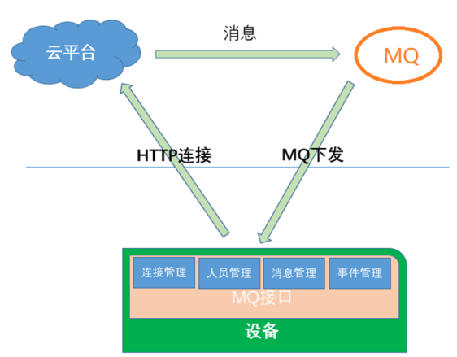
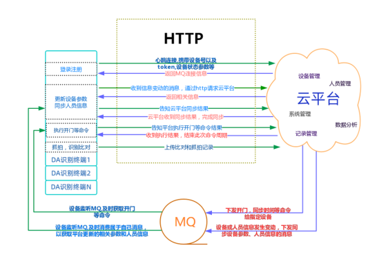
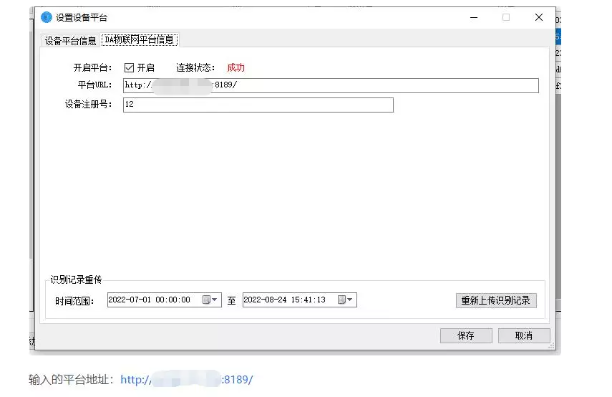
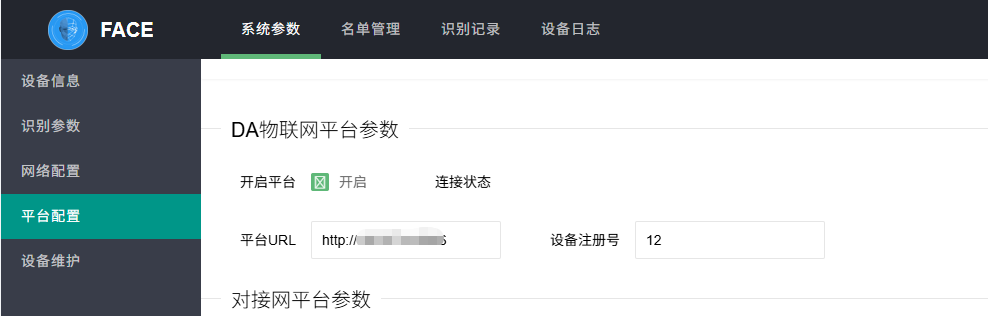
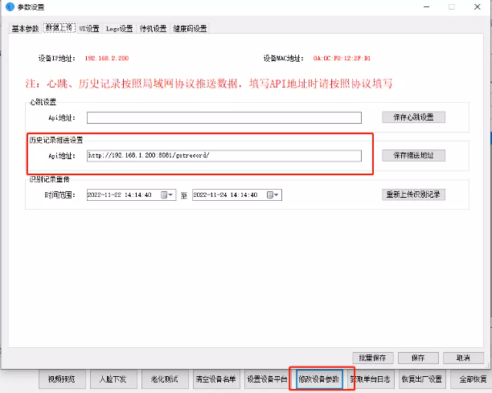

# 07 设备对接协议（RV1109 云对接）

| 项目 | 内容 |
|---|---|
| 本文性质 | **厂商协议整理稿**，供我方参考与备选方案比对，不是业务需求文档 |
| 原文标题 | RV1109云对接协议（标准版固件） |
| 原文链接 | <https://docs.qq.com/doc/DRmlpeUNzbk9MbU1C> |
| 整理日期 | 2026-11-16 |
| 整理方式 | 从腾讯文档在线正文按原文顺序抽取文字、表格、代码块与截图；截图已下载至 `assets/07-rv1109-cloud/` |
| 在本项目中的定位 | **本期不采用**：客户不接入厂商云，采用局域网 HTTP 直连（见 [06](./06-设备对接协议-局域网HTTP.md)）。本文件仅用于备选方案评估与参数含义对照 |
| 关联文档 | [06 局域网 HTTP 对接](./06-设备对接协议-局域网HTTP.md) · [08 设备联调与心跳配置指南](./08-设备联调与心跳配置指南.md) |

> **抽取说明**
> 1. 原文大量示例以截图形式给出，本次已把可下载的截图下载并在原位引用；代码块为原文文本，未改写。
> 2. 原文目录本身有重复编号（两个“9”、8 章缺父级标题等），此处保持原样。
> 3. 原文中的示例地址 `192.168.1.16:5389`、`47.104.64.115:9001` 等为厂商示例值。

## 0. 方案比对：云对接 vs 局域网 HTTP（我方补充，非原文）

| 维度 | 局域网 HTTP（本期采用） | 云对接（本文件） |
|---|---|---|
| 网络前提 | 平台与设备同一内网，能访问设备 8091 端口 | 设备能访问平台公网/内网地址，平台需自建 MQTT（EMQX，MQTT 3.1.1） |
| 设备侧配置 | 只需设备 IP 与密码 | 需配置平台接口地址 + 设备注册号，登录后拿 `token` 与 `mqinfo` |
| 登录 | `POST /deviceLogin`（body 内 `password`） | `POST /device/login`，返回 `token` + MQTT 连接信息 |
| 指令下发 | 直接 HTTP 调用具体接口 | MQTT，topic = `dev_sno`，按 `method` 区分指令 |
| 下发/删除人员 | `/addDeviceWhiteList`、`/deleteDeviceWhiteList` | `sync_person`、`sync_card`、`delete_person`、`delete_all` |
| 查询人员 | `/getAllDeviceIdWhiteList`、`/getDeviceWhiteListDetailByIdNum` | `get_person_all`、`get_person`、`check_consistency` |
| 远程开门 | `/setDeviceRemoteOpen` | `open_door` |
| 记录上传 | `/setIdentifyCallBck` 配置回调地址，设备主动推送 | `POST /record/upload/online`；另可 `setDeviceRecord_revert` 重推 |
| 二维码 | 在线比对识别（`type=qr`）实现动态码实时校验 | 先设置二维码识别方式（在线/离线），再走在线比对或本地名单 |
| 心跳 | 设备每 30 秒推 `heartBeatIp`，或平台调 `/heartBeat` | 设备每 30 秒登录一次平台（HTTP `/device/login`）维持心跳 |
| 适用场景 | 单点、内网、平台完全自控（本项目） | 多设备远程运维、跨网络部署 |

> **可借鉴之处**：云协议对“二维码识别设置”“访客名单通行时间”“在线比对自定义语音”描述更完整，可用于反推局域网设备参数（如 `Comparison`、`comparisonAddress`、`recogModeID`）的取值含义。

---

## 原文（按原文顺序整理，未改写）

RV1109云对接协议

说明：此文档适用于标准版本，定制版本差异请咨询技术人员

### 1 更新日志

| 更新说明 | 更新日期 |
|---|---|
| 首次发布版本 | 2021-03-05 |
| 合并了接口 | 2021-03-29 |
| 删除名单workNo字段，新增远程升级指令 | 2021-04-21 |
| 增加二维码识别设置，增加访客名单通行时间设置 | 2021-06-10 |
| 增加了云说明 | 2021-11-17 |
| 增加时间段控制接口 | 2021-12-07 |
| 记录上传增加健康码字段 | 2021-12-28 |
| 附件中增加了前置设置说明 | 2022-04-13 |
| 新增远程重启接口 | 2022-06-11 |
| 新增重新推送设备记录接口 | 2022-07-02 |
| 注意：设备修复了人员有效期，平台若下发人员有效期必须要更新（查看【云端获取设备人员信息】接口） | 2022-07-21 |
| 设置测温参数接口、获取/设置设备基本参数接口新增配置参数 | 2022-11-14 |
| 增加在线比对接口<br>（新升级包请通过<http://47.104.64.115:9001/> 获取） | 2023-02-17 |
| 在线比对接口增加自定义语音返回 | 2023-05-12 |
| 增加获取设备人员信息接口、调整文档目录 | 2023-08-18 |
| 补充了获取日志接口 （设备版本支持） | 2023-01-02 |
| 增加6.7 仅下发卡号的接口（无照片人员） | 2023-01-25 |
| 修改6.6 获取访客时间 | 2024-09-12 |

### 2 文档面向对象

本文档的面向对象如下：

| 读者分类 | 目的 |
|---|---|
| 技术人员 | 了解设备对接接口的大致内容 |
| 系统开发人员 | 理解设备对接接口，进行开发对接 |

### 3 架构说明

#### 3.1 基于MQ的端云系统架构设计

终端设备提供了一套接口协议，用于规范云平台和终端设备之间的消息、比对事件、人员信息等行为，详细的系统框架如下：

说明：此文档中涉及的云平台指阅读方（对接方）的云平台，此文档涉及的接口所有都是设备直联阅读方（对接方）的平台。

架构中的MQ服务器需要阅读方（对接方）搭建。



支持MQTT(EMQX)

（设备mqtt版本号：3.1.1）

#### 3.2 设备与平台通信



MQTT(EMQX)

### 4 云端下发指令说明

#### 4.1 约定

平台通过 MQTT 下发信息到设备，对于MQTT，设备以dev_sno作为topic。

消息体为json字符串

设备根据 method 进行命令识别

### 5 设备登录

描述

接口地址： 执行登陆、人员信息获取、识别上传等信息通信的服务器接口地址

设备注册号：可按需配置，用于多公司平台，区分设备所在公司、区域等信息，如果没有这个要求的平台可以任意填写即可。

接口地址、设备的注册号在设备配置中进行配置

设备启动后，通过配置的：接口地址+配置的注册号以及设备序列号，执行登陆请求。登录成功获取token后才能执行后续操作。

平台验证设备登录是否合法，合法设备返回mqtt连接信息及token。

合法的设备才会获取 token，作为超时检验和权限校验。

token的用于平台判断设备的有效性，平台可定时更新token，对于没有这个要求的平台，可以一直使用同一个token。

心跳连接：设备每30秒登录一次平台，保持通信，并上报相关状态参数。保持心跳连接的设备。

端口：5389 端口可自定义

请求URI

/device/login

请求方式

POST

参数类型

application/json

参数

| 参数名 | 必选 | 类型 | 说明 |
|---|---|---|---|
| dev_sno | 是 | string | 设备号（设备MAC地址） |
| sign_type | 是 | string | 签名类型(固定为dev_sign) |
| register_no | 是 | string | 设备注册号 (暂无意义) |
| type | 是 | int | 设备类型: 1门禁机 |
| name | 是 | string | 设备名称 |
| throughType | 是 | string | 出入口, 1:出 2:入 |
| threshold | 是 | float | 识别阈值[0.0-100.0] |
| detectAlive | 是 | string | 检测活体，close：不开启活体检测，IRAlive：IRAlive模式 |
| openIRWindow | 是 | bool | 是否开启IR小窗口 |
| retryInterval | 是 | string | 人脸识别去重时间， 单位：秒 |
| isFirst | 否 | bool | 是否首次登录。如果在中途切换其它平台账号，再次登录此参数为true |

**请求示例**

```json
{
    "detectAlive":"IRAlive",
    "dev_sno":"FF:0C:F4:12:67:05",
    "device_ip":"192.168.1.135",
    "distance":4,
    "isFirst":false,
    "name":"Terminal",
    "openIRWindow":false,
    "register_no":"12",
    "retryInterval":"2.0",
    "sign_type":"dev_sign",
    "threshold":70,
    "throughType":"2",
    "type":1
}
```

设备使用MQTT协议，云端返回示例

| 参数名 | 必选 | 类型 | 说明 |
|---|---|---|---|
| code | 是 | int | 0:成功 非0:失败 |
| dev_sno | 是 | string | 设备号（设备MAC地址） |
| msg | 是 | string | 登录成功 |
| success | 是 | bool | true |
| token | 是 | string |   |
| mqinfo | 是 | object | mqtt连接信息 |
| mqinfo.host | 是 | string |   |
| mqinfo.keepalive | 是 | int |   |
| mqinfo.login | 是 | string |   |
| mqinfo.password | 是 | string |   |
| mqinfo.port | 是 | int | 端口 |
| mqinfo.qos | 是 | int |   |
| mqinfo.topic | 是 | string | 设备的MAC地址 |

**返回示例**

```json
{
    "code":0,
    "msg":"登陆成功",
    "success":true,
    "dev_sno":"0A:0C:F4:12:67:05",
    "token":"eyJkZXZpY2V",
    "mqinfo":{
        "host":"8.xx.1x.xx",
        "keepalive":60,
        "login":"admin",
        "password":"admin",
        "port":1883,
        "qos":1,
        "topic":"FF:AA:F4:12:67:05"
    }
}
```

配置登录地址的方法请查看 附件一

设备是通过http请求平台后，平台返回mq登录地址

设置后登录不了 MQTT？请严格按照上面的字段json检测，并通过mqtt工具检查是否是mqtt服务器信息不对

### 6 名单管理接口

人员身份类型

person_type对应的人员类型

| 值 | 类型 | 说明 |
|---|---|---|
| 0 | string | 待定 |
| 1 | string | 访客（人员下发时设置为访客的人员定义为访客，设备上未录入的人员直接人证比对的同定义为访客） |
| 2 | string | 陌生人 |
| 4 | string | 白名单（员工） |
| 5 | string | 黑名单 |

#### 6.1 云端下发同步人员指令

用途：云端人员新增或修改后，下发同步人员指令到设备。

每组下发10个人，请勿一次性将平台所有人员通过一组下发到设备

命令参数：

| 参数名 | 必选 | 类型 | 说明 |
|---|---|---|---|
| method | 是 | string | 指令名称，值为sync_person |
| data | 是 | object | 数据 |
| notify | 是 | string | 设备反馈执行结果的请求地址 |
| params | 是 | object | 保留字段，notify需要的params参数，由云端服务提供 |

data参数说明

| 参数名 | 必选 | 类型 | 说明 |
|---|---|---|---|
| path | 是 | string | 请求获取人员信息接口的云端地址 |
| path_params | 是 | object | 请求获取人员信息接口需要携带的参数 |

path_params参数说明

| 参数名 | 必选 | 类型 | 说明 |
|---|---|---|---|
| dev_sno | 是 | string | 设备MAC |
| limit | 是 | int | 每个指令同步人员 数量<br>(建议每次下发10个人员，人员多时再下发下一批次即可，直到下发完成；平台也可直接将所有人员一次性下发下去，但是由于下发耗时较长，会阻塞整个mqtt和http其它指令，直接导致设备登录接口不会再继续请求直到下发完成后登录接口请求再持续，其它指令同理 （即大批量一次下发时会导致设备不再请求登录接口直到下发完成） |
| offset | 是 | int | 已同步人员数量 |
| total | 是 | int | 需要同步的人员总数 |
| person_list | 是 | string | 人员id列表（请勿下发0开头的person_id） |
| person_type | 是 | string | 人员类型 |

**示例**

```json
{
	"method": "sync_person",
	"data": {
		"path": "http://192.168.1.16:5389/device/sync_person",
		"path_params": {
			"dev_sno": "04:12:53:FA:21:DA",
			"limit": 10,
			"offset": 0,
			"total": 1,
			"person_list": ["99064", "99067"],
			"person_type": "4"
		}
	},
	"notify": "http://192.168.1.16:5389/device/notify",
	"params": {}
}
```

设备请求data.path获取人员信息：

接口说明： 设备请求该批次person_id的所有人员信息

请求方式: POST

Content-Type: application/json

```json
{
    "dev_sno":"04:12:53:FA:21:DA",
    "path":"http://",
    "path_params":{
        "dev_sno":"04:12:53:FA:21:DA",
        "limit":1,
        "offset":0,
        "person_list":[
            "452154515",
            "14541564"
        ],    //设备向请求请求数组内人员id的所有人员信息
        "person_type":"4",
        "total":""
    },
    "token":"b96266221d232f04"
}
```

平台返回人员信息

| 参数名 | 类型 | 说明 |
|---|---|---|
| person_id | string | 人员id |
| person_name | string | 姓名 |
| person_type | string | 人员类型，1访客， 4员工 |
| sex | int | 性别 1男 2女 0未知 |
| templateImgUrl | array | 模板照（请平台开发人员做照片压缩功能，图片大小控制在500K以内，分辨率大于400*400,小于1080*1920） |
| ic_card | string | ic卡 |
| qr | string | 二维码 |
| id_card | string | 证件号 |
| birthday | string | 出生日期 |
| throughDateFrom | string | 访客通行起始日期(yyyy-MM-dd)<br>注意：在dd后面加个空格 |
| throughMomentFrom | string | 访客通行起始时间(HH:mm:ss)<br>24小时制注意格式 |
| throughDateTo | string | 访客通行截止日期(yyyy-MM-dd)<br>注意：在dd后面加个空格 |
| throughMomentTo | string | 访客通行截止时间(HH:mm:ss)<br>注意格式<br>说明：日期、时间传空时人员有效期默认为1970-2038年 |
| TimeGroupId | string | 普通时间段（平台未下发此字段时默认为0）<br>0:任意时间识别成功都可行, 1-4周一到周日指定时间段内识别成功才能通行 |
| SpecialTimeGroupId | string | 特殊时间段ID |

平台返回示例

```json
{
	"code": 0,
	"msg": "OK",
	"offset": 30,
	"person_list": [{
		"birthday": "",
		"ic_card": "",
		"id_card": "51032119xxxx043681",
		"person_id": "292068",
		"person_name": "xxx",
		"person_type": "4",
		"sex": 2,
		"templateImgUrl": [
			"http://XXXXX.oss-cn-shenzhen.aliyuncs.com/group2/a2fb8cbe5da13a99be662a4845e74578.jpg"
		],
		"throughDateFrom": "",
		"throughMomentFrom": "",
		"throughDateTo": "",
		"throughMomentTo": "",
		"TimeGroupId"：""
	}],
	"success": true
}
```

设备请求云端反馈同步结果：

接口说明： 设备反馈该批次10个人入库情况，然后云端下发下一批次人员

请求方式: POST

Content-Type: application/json

请求参数:

| 参数名 | 必选 | 类型 | 说明 |
|---|---|---|---|
| dev_sno | 是 | string | 设备MAC |
| token | 是 | string | token值 |
| success | 是 | bool | 成功或失败: 此次接收人员数据是否成功，false表示需要平台再次下发该批次人员数据 |
| method | 是 | string | sync_person |
| msg | 是 | string | 说明 |
| person_type | 是 | string | 人员类型 |
| successful | 是 | string | 成功入库人员id列表，字符串 |
| failed | 是 | object | 入库失败人员id列表 |
| params | 是 | object | 见示例，可为空 |

failed参数说明

| 参数名 | 必选 | 类型 | 说明 |
|---|---|---|---|
| person_id | 是 | string | 人员id |
| info | 是 | object | 失败说明 |
| info.img_index | 是 | int | 模板照片序号，从0开始计数 |
| info.reason | 是 | string | 失败原因 |

**示例**

```
1.   {
2.       "dev_sno":"test_1234",
3.       "token""d0e3be35473b2a331f05cc0c7dc6a9b",
4.       "method":"sync_person",
5.       "person_type":"1",
6.       "success":true,
7.       "successful":"["128","130"]",
8.       "failed":[
9.           {
10.            "person_id":"151",
11.            "info":[
12.                {"img_index":0,  "reason":  "没有检测到人脸"},
13.                {"img_index":1,  "reason":  "没有检测到人脸"},
14.                {"img_index":2,  "reason":  "没有检测到人脸"}
15.            ]
16.        },
17.    ],
18.    "msg":"同步成功",
19.    "params":{
20.        "offset":0,
21.        "limit":10,
22.        "total":58,
23.    }
24.}
```

云端返回：

| 参数名 | 必选 | 类型 | 说明 |
|---|---|---|---|
| code | 是 | int | 状态码， 0成功，非0异常 |
| msg | 是 | string | 说明 |
| success | 是 | bool | 平台接收成功或失败 |

**示例**

```json
 {
  "code": 0,
  "msg": "OK",
  "success": true
 }
```

#### 6.2 云端下发删除人员指令

用途：删除设备部分人员

命令参数：

| 参数名 | 必选 | 类型 | 说明 |
|---|---|---|---|
| method | 是 | string | 指令名称，值为delete_person |
| data | 是 | object | 数据 |
| notify | 是 | string | 设备反馈执行结果的请求地址 |
| params | 是 | object | 保留字段，notify需要的params参数，由云端服务提供 |
| data.person_list | 是 | array | 人员id列表 |
| data.person_type | 是 | string | 人员类型 |

**示例**

```json
{
	"method": "delete_person",
	"data": {
		"person_list": [12, 34, 54],
		"person_type": "4"
	},
	"notify": "http://192.168.1.16:5389/device/notify",
	"params": {}
}
```

设备请求云端反馈执行结果：

注：大批量删除人员，耗时很长，设备在这种情况下，可能不会反馈执行结果

请求方式: POST

Content-Type: application/json

请求参数:

| 参数名 | 必选 | 类型 | 说明 |
|---|---|---|---|
| dev_sno | 是 | string | 设备MAC |
| token | 是 | string | token值 |
| success | 是 | bool | 成功或失败 |
| method | 是 | string | 指令名称 |
| msg | 是 | string | 说明 |
| params | 是 | object | 保留字段，notify需要的params参数，由云端服务提供 |

**示例**

```json
{
	"dev_sno": " 04:12:53:FA:21:DA",
	"token": "38f8cc4bc6fb4e82c78175e2d56",
	"method": "delete_person",
	"success": true,
	"msg": "成功",
	"params": {}
}
```

云端返回：

| 参数名 | 必选 | 类型 | 说明 |
|---|---|---|---|
| code | 是 | int | 状态码， 0成功，非0异常 |
| msg | 是 | string | 说明 |
| success | 是 | bool | 平台接收成功或失败 |

**示例**

```json
{
  "code": 0,
  "msg": "OK",
  "success": true
 }
```

#### 6.3 云端删除所有人员

用途：清除设备上所有人员

命令参数：

| 参数名 | 必选 | 类型 | 说明 |
|---|---|---|---|
| method | 是 | string | 指令名称，值为delete_all |
| data | 是 | object | 数据 |
| notify | 是 | string | 设备反馈执行结果的请求地址 |
| params | 是 | object | 保留字段，notify需要的params参数，由云端服务提供 |

**示例**

```json
{
	"method": "delete_all",
	"data": {},
	"notify": "http://192.168.1.16:5389/device/notify",
	"params": {}
}
```

设备请求云端反馈执行结果：

设备清除大批量人员，需要很长时间，这种情况下，可能不会反馈执行结果。

请求方式: POST

Content-Type: application/json

请求参数:

| 参数名 | 必选 | 类型 | 说明 |
|---|---|---|---|
| dev_sno | 是 | string | 设备MAC |
| token | 是 | string | token值 |
| success | 是 | bool | 成功或失败 |
| method | 是 | string | 指令名称 |
| msg | 是 | string | 说明 |
| params | 是 | object | 保留字段，notify需要的params参数，由云端服务提供 |

**示例**

```json
{
	"dev_sno": " 04:12:53:FA:21:DA",
	"token": "38f8cc4bc6fb4e82c78175e2d56",
	"method": "delete_all",
	"success": true,
	"msg": "删除成功",
	"params": {}
}
```

云端返回：

| 参数名 | 必选 | 类型 | 说明 |
|---|---|---|---|
| code | 是 | int | 状态码， 0成功，非0异常 |
| msg | 是 | string | 说明 |
| success | 是 | bool | 平台接收成功或失败 |

**示例**

```json
{
  "code": 0,
  "msg": "OK",
  "success": true
 }
```

#### 6.4 云端下发检测一致性指令

用途：当平台检测到设备和平台人员数量不一致时，下发此指令，设备将上报人员id给平台进一步处理

命令参数：

| 参数名 | 必选 | 类型 | 说明 |
|---|---|---|---|
| method | 是 | string | 指令名称，值为 check_consistency |
| data | 是 | object | 数据 |
| notify | 是 | string | 设备反馈执行结果的请求地址 |
| params | 是 | object | 保留字段，notify需要的params参数，由云端服务提供 |

data参数：

| 参数名 | 必选 | 类型 | 说明 |
|---|---|---|---|
| data.path | 是 | string | 设备访问此接口，上报人员id |

**示例**

```json
{
    "method":"check_consistency",
    "data":{
        "path":"http://192.168.1.16:5389/device/check_consistency"
    },
    "notify":"http://192.168.1.16:5389/device/notify",
    "params":{
        "dev_sno":" 04:12:53:FA:21:DA",
        "token":"38f8cc4bc6fb4e82c78175e2d56",
        "params":{
            "personInfo":[
                {
                    "person_type":"4",
                    "person_list":[
                    ]
                },
                {
                    "person_type":"4",
                    "person_list":[
                    ]
                }
            ]
        }
    }
}
```

设备请求data.path上报人员id：

请求方式: POST

Content-Type: application/json

请求参数:

| 参数名 | 必选 | 类型 | 说明 |
|---|---|---|---|
| dev_sno | 是 | string | 设备sn |
| token | 是 | string | token值 |
| params | 是 | object | 人员信息 |

params参数：

| 参数名 | 必选 | 类型 | 说明 |
|---|---|---|---|
| params.personInfo | 是 | array | 人员信息 |
| params.personInfo.person_type | 是 | string | 人员类型 |
| params.personInfo.person_list | 是 | array | 人员id列表。 |

**示例**

```json
{
    "dev_sno":"04:12:53:FA:21:DA",
    "params":{
        "personInfo":[
            {
                "person_list":[
                    "10666",
                    "100555",
                    "10022",
                    "10001"
                ],
                "person_type":"0"
            },
            {
                "person_list":[

                ],
                "person_type":"1"
            },
            {
                "person_list":[

                ],
                "person_type":"2"
            }
        ]
    },
    "token":"eyJkZXZpY2VfaWQiOjE2MTQsImRldmljZV9t"
}
```

云端返回：

| 参数名 | 必选 | 类型 | 说明 |
|---|---|---|---|
| code | 是 | int | 状态码， 0成功，非0异常 |
| msg | 是 | string | 说明 |
| success | 是 | bool | 平台接收成功或失败 |

**示例**

```json
{
"code": 0,
"msg": "OK",
"success": true
 }
```

#### 6.5 云端获取设备人员列表

用途：云端获取人脸设备上的人员列表

命令参数：

| 参数名 | 必选 | 类型 | 说明 |
|---|---|---|---|
| method | 是 | string | 指令名称，值为 get_person_all |
| data | 是 | object | 数据 |
| notify | 是 | string | 设备反馈执行结果的请求地址 |
| params | 是 | object | 保留字段，notify需要的params参数，由云端服务提供 |

data参数说明

| 参数名 | 必选 | 类型 | 说明 |
|---|---|---|---|
| path | 是 | string | 请求获取人员信息接口的云端地址 |

命令下发示例：

```json
{
    "method":"get_person_all",
    "data":{
        "path":"http://192.168.1.16:5389/device/get_person_all"
    },
    "params":{
    }
}
```

设备请求data.path上报人员列表：

请求方式: POST

Content-Type: application/json

| 参数名 | 必选 | 类型 | 说明 |
|---|---|---|---|
| dev_sno | 是 | string | mac |
| token | 是 | string |   |
| person_list | 是 | object |   |
| person_list.person_id | 是 | array | 人员id |
| person_list.name | 是 | string | 人员姓名 |
| person_list.id_card | 是 | array | 人员身份证号码 |

上报示例：

```json
{
    "dev_sno":" 04:12:53:FA:21:DA",
    "token":"f9k4l8ds3e92w02d9c82013na0s9",
    "person_list":[
        {
            "person_id":"⼈员ID",
            "name":"姓名",
            "id_card":"身份证号"
        }，{
            "person_id":"⼈员ID",
            "name":"姓名",
            "id_card":"身份证号"
        }
    ]
}
```

云端返回：

| 参数名 | 必选 | 类型 | 说明 |
|---|---|---|---|
| code | 是 | int | 状态码， 0成功，非0异常 |
| msg | 是 | string | 说明 |
| success | 是 | bool | 平台接收成功或失败 |

**返回示例**

```json
{
	"code": 0,
	"msg": "OK",
	"success": true
}
```

#### 6.6 云端获取设备人员详情

用途：云端下发指定的人员id获取人脸设备上的对应人员的详细信息

命令参数：

| 参数名 | 必选 | 类型 | 说明 |
|---|---|---|---|
| method | 是 | string | 指令名称，值为 get_person |
| data | 是 | object | 数据 |
| notify | 是 | string | 设备反馈执行结果的请求地址 |
| params | 是 | object | 保留字段，notify需要的params参数，由云端服务提供 |

data参数说明

| 参数名 | 必选 | 类型 | 说明 |
|---|---|---|---|
| path | 是 | string | 请求获取人员信息接口的云端地址 |
| person_id | 是 | string | 需要查询的人员id |

命令下发示例：

```json
{
    "method":"get_person",
    "data":{
        "path":"http://192.168.1.16:5389/device/get_person_all" ，
        "person_id":"1231231",
    },
    "params":{
    }
}
```

设备请求data.path上报人员详情 ：

请求方式: POST

Content-Type: application/json

| 参数名 | 必选 | 类型 | 说明 |
|---|---|---|---|
| dev_sno | 是 | string | mac |
| token | 是 | string |   |
| person | 是 | object |   |
| person.person_id | 是 | array | 人员id |
| person.name | 是 | string | 人员姓名 |
| person.id_card | 是 | array | 人员身份证号码 |
| person.ic_card | 否 |   | IC卡号 |
| person.person_type | 是 |   | 人员类型 |
| person.photo | 是 |   | 人员照片 |
| person.throughDateFrom | 是 |   | 访客通行起始日期(yyyy-MM-dd HH:mm:ss) |
| person.throughMomentFrom | 是 |   | 访客通行截止日期(yyyy-MM-dd HH:mm:ss) |
| person.TimeGroupId | 否 |   | 时间组id |

上报示例：

```json
{
    "dev_sno":" 04:12:53:FA:21:DA",
    "token":"f9k4l8ds3e92w02d9c82013na0s9",
    "person":{
        "birthday":"",
        "ic_card":"",
        "id_card":"51032119xxxx43681",
        "person_id":"292068",
        "person_name":"xxx",
        "person_type":"4",
        "sex":2,
        "photo":"/9j…………………",
        "throughDateFrom":"",
        "throughMomentFrom":"",
        "throughDateTo":"",
        "throughMomentTo":"",
        "TimeGroupId":""
    }
}
```

云端返回：

| 参数名 | 必选 | 类型 | 说明 |
|---|---|---|---|
| code | 是 | int | 状态码， 0成功，非0异常 |
| msg | 是 | string | 说明 |
| success | 是 | bool | 平台接收成功或失败 |

**返回示例**

```json
{
	"code": 0,
	"msg": "OK",
	"success": true
}
```

#### 6.7 云端下发同步卡号指令

用途：用于下发无照片人员的卡号，删除时与删除人员的接口共用。

下发的数组大小可以按照下发人员指令的大小下发，也可以根据业务需求自行确认下发数组的大小，建议每个数组下发不大于100条数据。

命令参数：

| 参数名 | 必选 | 类型 | 说明 |
|---|---|---|---|
| method | 是 | string | 指令名称，值为sync_card |
| data | 是 | object | 数据 |
| notify | 是 | string | 设备反馈执行结果的请求地址 |
| params | 是 | object | 保留字段，notify需要的params参数，由云端服务提供 |

data参数说明

| 参数名 | 必选 | 类型 | 说明 |
|---|---|---|---|
| path | 是 | string | 请求获取人员信息接口的云端地址 |
| path_params | 是 | object | 请求获取人员信息接口需要携带的参数 |

path_params参数说明

| 参数名 | 必选 | 类型 | 说明 |
|---|---|---|---|
| dev_sno | 是 | string | 设备MAC |
| limit | 是 | int | 每个指令同步人员 数量 |
| offset | 是 | int | 已同步人员数量 |
| total | 是 | int | 需要同步的人员总数 |
| person_list | 是 | string | 人员id列表 |
| person_type | 是 | string | 人员类型 |

**示例**

```json
{
	"method": "sync_card",
	"data": {
		"path": "http://192.168.1.16:5389/device/sync_person",
		"path_params": {
			"dev_sno": "04:12:53:FA:21:DA",
			"limit": 10,
			"offset": 0,
			"total": 1,
			"person_list": "["99064", "99067"]",
			"person_type": "4"
		}
	},
	"notify": "http://192.168.1.16:5389/device/notify",
	"params": {}
}
```

设备请求data.path获取人员信息：

接口说明： 设备请求该批次person_id的所有人员信息

请求方式: POST

Content-Type: application/json

```json
{
    "dev_sno":"04:12:53:FA:21:DA",
    "path":"http://",
    "path_params":{
        "dev_sno":"04:12:53:FA:21:DA",
        "limit":1,
        "offset":0,
        "person_list":[
            "452154515",
            "14541564"
        ],    //设备向请求请求数组内人员id的所有人员信息
        "person_type":"4",
        "total":""
    },
    "token":"b96266221d232f04"
}
```

平台返回人员信息

| 参数名 | 类型 | 说明 |
|---|---|---|
| person_id | string | 人员id |
| person_name | string | 姓名 |
| person_type | string | 人员类型，1访客， 4员工 |
| sex | int | 性别 1男 2女 0未知 |
| ic_card | string | ic卡 |
| qr | string | 二维码 |
| id_card | string | 证件号 |
| birthday | string | 出生日期 |
| throughDateFrom | string | 访客通行起始日期(yyyy-MM-dd)<br>注意：在dd后面加个空格 |
| throughMomentFrom | string | 访客通行起始时间(HH:mm:ss)<br>24小时制注意格式 |
| throughDateTo | string | 访客通行截止日期(yyyy-MM-dd)<br>注意：在dd后面加个空格 |
| throughMomentTo | string | 访客通行截止时间(HH:mm:ss)<br>注意格式 |
| TimeGroupId | string | 普通时间段（平台未下发此字段时默认为0）<br>0:任意时间识别成功都可行, 1-4周一到周日指定时间段内识别成功才能通行 |
| SpecialTimeGroupId | string | 特殊时间段ID |

平台返回示例

```json
{
	"code": 0,
	"msg": "OK",
	"offset": 30,
	"person_list": [{
		"birthday": "",
		"ic_card": "",
		"id_card": "51032119xxxx043681",
		"person_id": "292068",
		"person_name": "xxx",
		"person_type": "4",
		"sex": 2,
		"throughDateFrom": "",
		"throughMomentFrom": "",
		"throughDateTo": "",
		"throughMomentTo": "",
		"TimeGroupId"：""
	}],
	"success": true
}
```

设备请求云端反馈同步结果：

接口说明： 设备反馈该批次10个人入库情况，然后云端下发下一批次人员

请求方式: POST

Content-Type: application/json

请求参数:

| 参数名 | 必选 | 类型 | 说明 |
|---|---|---|---|
| dev_sno | 是 | string | 设备MAC |
| token | 是 | string | token值 |
| success | 是 | bool | 成功或失败: 此次接收人员数据是否成功，false表示需要平台再次下发该批次人员数据 |
| method | 是 | string | sync_person |
| msg | 是 | string | 说明 |
| person_type | 是 | string | 人员类型 |
| successful | 是 | string | 成功入库人员id列表，字符串 |
| failed | 是 | object | 入库失败人员id列表 |
| params | 是 | object | 见示例，可为空 |

failed参数说明

| 参数名 | 必选 | 类型 | 说明 |
|---|---|---|---|
| person_id | 是 | int | 人员id |
| info | 是 | object | 失败说明 |
| info.reason | 是 | string | 失败原因 |

**示例**

```json
   {
      "dev_sno":"test_1234",
      "token""d0e3be35473b2a331f05cc0c7dc6a9b",
     "method":"sync_person",
      "person_type":"1",
     "success":true,
    "successful":"[128, 129, 140, 141, 142, 143, 144, 150]",
      "failed":[
           {
            "person_id":151,
          "info":[
             ]
        },
    ],
    "msg":"同步成功",
     "params":{
       "offset":0,
       "limit":10,
        "total":58,
    }
}
```

云端返回：

| 参数名 | 必选 | 类型 | 说明 |
|---|---|---|---|
| code | 是 | int | 状态码， 0成功，非0异常 |
| msg | 是 | string | 说明 |
| success | 是 | bool | 平台接收成功或失败 |

**示例**

```json
 {
  "code": 0,
  "msg": "OK",
  "success": true
 }
```

### 7 设备运行信息

#### 7.1 云端开门

用途：下发开门命令到设备，设备开启闸机等门禁

命令参数：

| 参数名 | 必选 | 类型 | 说明 |
|---|---|---|---|
| method | 是 | string | 指令名称，值为open_door |
| data | 是 | object | 数据 |
| notify | 是 | string | 设备反馈执行结果的请求地址 |
| params | 是 | object | 保留字段，notify需要的params参数，由云端服务提供 |

**示例**

```json
{
	"method": "open_door",
	"data": {},
	"notify": "http://192.168.1.16:5389/device/notify",
	"params": {}
}
```

设备请求云端反馈执行结果：

请求方式: POST

Content-Type: application/json

请求参数:

| 参数名 | 必选 | 类型 | 说明 |
|---|---|---|---|
| dev_sno | 是 | string | 设备MAC |
| token | 是 | string | token值 |
| success | 是 | bool | 成功或失败 |
| method | 是 | string | 指令名称 |
| msg | 是 | string | 说明 |
| params | 是 | object | 保留字段，notify需要的params参数，由云端服务提供 |

**示例**

```json
{
	"dev_sno": "JWSZ1209323212",
	"token": "38f8cc4bc6fb4e82c78175e2d56",
	"method": "open_door",
	"success": true,
	"msg": "开门成功",
	"params": {}
}
```

云端返回：

| 参数名 | 必选 | 类型 | 说明 |
|---|---|---|---|
| code | 是 | int | 状态码， 0成功，非0异常 |
| msg | 是 | string | 说明 |
| success | 是 | bool | 平台接收成功或失败 |

**返回示例**

```json
{
	"code": 0,
	"msg": "OK",
	"success": true
}
```

#### 7.2 云端设置系统时间

用途：设置设备时间

命令参数：

| 参数名 | 必选 | 类型 | 说明 |
|---|---|---|---|
| method | 是 | string | 指令名称，值为sync_time |
| notify | 是 | string | 设备反馈执行结果的请求地址 |
| params | 是 | object | 保留字段，notify需要的params参数，由云端服务提供 |
| data | 是 | object | 数据 |
| data.time | 是 | string | 系统时间yyyy-MM-dd hh:mm:ss。<br>例：”2020-01-01 12:00:00” |

**示例**

```json
{
	"method": "sync_time",
	"data": {
		"time": "2020-01-01 12:00:00"
	},
	"notify": "http://192.168.1.16:5389/device/notify",
	"params": {}
}
```

设备请求云端反馈执行结果：

请求方式: POST

Content-Type: application/json

请求参数:

| 参数名 | 必选 | 类型 | 说明 |
|---|---|---|---|
| dev_sno | 是 | string | 设备MAC |
| token | 是 | string | token值 |
| success | 是 | bool | 成功或失败 |
| method | 是 | string | 指令名称 |
| msg | 是 | string | 说明 |
| params | 是 | object | 保留字段，notify需要的params参数，由云端服务提供 |

**示例**

```json
{
	"dev_sno": "JWSZ1209323212",
	"token": "38f8cc4bc6fb4e82c78175e2d56",
	"method": "sync_time",
	"success": true,
	"msg": "设置成功",
	"params": {}
}
```

云端返回：

| 参数名 | 必选 | 类型 | 说明 |
|---|---|---|---|
| code | 是 | int | 状态码， 0成功，非0异常 |
| msg | 是 | string | 说明 |
| success | 是 | bool | 平台接收成功或失败 |

**返回示例**

```json
{
	"code": 0,
	"msg": "OK",
	"success": true
}
```

#### 7.3 云端重置设备参数

用途：恢复设备设置参数至默认值

命令参数：

| 参数名 | 必选 | 类型 | 说明 |
|---|---|---|---|
| method | 是 | string | 指令名称，值为reset_device |
| data | 是 | object | 数据 |
| notify | 是 | string | 设备反馈执行结果的请求地址 |
| params | 是 | object | 保留字段，notify需要的params参数，由云端服务提供 |

**示例**

```json
{
	"method": "reset_device",
	"data": {},
	"notify": "http://192.168.1.16:5389/device/notify",
	"params": {}
}
```

设备请求云端反馈执行结果：

请求方式: POST

Content-Type: application/json

请求参数:

| 参数名 | 必选 | 类型 | 说明 |
|---|---|---|---|
| dev_sno | 是 | string | 设备MAC |
| token | 是 | string | token值 |
| success | 是 | bool | 成功或失败 |
| method | 是 | string | 指令名称 |
| msg | 是 | string | 说明 |
| params | 是 | object | 保留字段，notify需要的params参数，由云端服务提供 |

**示例**

```json
{
	"dev_sno": "JWSZ1209323212",
	"token": "38f8cc4bc6fb4e82c78175e2d56",
	"method": "reset_device",
	"success": true,
	"msg": "设置成功",
	"params": {}
}
```

云端返回：

| 参数名 | 必选 | 类型 | 说明 |
|---|---|---|---|
| code | 是 | int | 状态码， 0成功，非0异常 |
| msg | 是 | string | 说明 |
| success | 是 | bool | 平台接收成功或失败 |

**示例**

```json
{
	"code": 0,
	"msg": "OK",
	"success": true
}
```

#### 7.4 云端设置测温参数

用途：设置设备测温的相关参数，此接口参数已经合并到set_basic_settings,但是该接口保留可以使用

命令参数：

| 参数名 | 必选 | 类型 | 说明 |
|---|---|---|---|
| method | 是 | string | 指令名称，值为sync_TMParams |
| data | 是 | object | 数据 |
| notify | 是 | string | 设备反馈执行结果的请求地址 |
| params | 是 | object | 保留字段，notify需要的params参数，由云端服务提供 |
| data.warningTemperature | 是 | string | 测温报警温度 |
| data.openHeatMap | 是 | bool | 是否开启热力图 |
| data.outSideDetectMode | 否 | int | 测温使用环境 0:标准模式 1:户外模式 |
| data.temperatureMode | 否 | int | 测温功能 0 不测温 1 测温+人脸识别 2 只测温 |

**示例**

```json
{
	"method": "sync_TMParams",
	"data": {
		"warningTemperature": "37.3",
		"openHeatMap": false
	},
	"notify": "http://192.168.1.16:5389/device/notify",
	"params": {}
}
```

设备请求云端反馈执行结果：

请求方式: POST

Content-Type: application/json

请求参数:

| 参数名 | 必选 | 类型 | 说明 |
|---|---|---|---|
| dev_sno | 是 | string | 设备MAC |
| token | 是 | string | token值 |
| success | 是 | bool | 成功或失败 |
| method | 是 | string | 指令名称 |
| msg | 是 | string | 说明 |
| params | 是 | object | 保留字段，notify需要的params参数，由云端服务提供 |

**示例**

```json
{
	"dev_sno": "JWSZ1209323212",
	"token": "38f8cc4bc6fb4e82c78175e2d56",
	"method": "sync_TMParams",
	"success": true,
	"msg": "设置成功",
	"params": {}
}
```

云端返回：

| 参数名 | 必选 | 类型 | 说明 |
|---|---|---|---|
| code | 是 | int | 状态码， 0成功，非0异常 |
| msg | 是 | string | 说明 |
| success | 是 | bool | 平台接收成功或失败 |

**示例**

```json
{
  "code": 0,
  "msg": "OK",
  "success": true
 }
```

#### 7.5 云端获取设备基本设置参数

用途：获取设备设置参数

命令参数：

| 参数名 | 必选 | 类型 | 说明 |
|---|---|---|---|
| method | 是 | string | 指令名称，值为get_basic_settings |
| data | 是 | object | 数据 |
| notify | 是 | string | 设备反馈执行结果的请求地址 |
| params | 是 | object | 保留字段，notify需要的params参数，由云端服务提供 |

**示例**

```json
{
	"method": "get_basic_settings",
	"data": {},
	"notify": "http://192.168.1.16:5389/device/upload_settings",
	"params": {}
}
```

设备请求云端上报参数：

请求方式: POST

Content-Type: application/json

请求参数:

| 参数名 | 必选 | 类型 | 说明 |
|---|---|---|---|
| dev_sno | 是 | string | 设备MAC |
| token | 是 | string | token值 |
| success | 是 | bool | 成功或失败 |
| method | 是 | string | 指令名称 |
| msg | 是 | string | 说明 |
| basicSettings | 是 | object | 设置参数 |

basicSettings：

| 参数名 | 必填 | 类型 | 说明 |
|---|---|---|---|
| name | 否 | string | 设备名称（默认值：Terminal） |
| location | 否 | string | 安装位置（默认值：Location） |
| throughType | 否 | string | 出入口, 1:出 2:入 |
| rebootEnable | 否 | bool | 定时重启 false 不开启，true 开启 |
| rebootTime | 否 | string | 定时重启时间，例： 000330每天凌晨3点30分重启<br>01xxxx-07xxxx分别为周一至周日 00xxxx为每天定时重启<br>设备默认每周二凌晨2-3点重启，无特殊情况可以不做此设置 |
| closingDelay | 否 | int | 开门延时，单位：秒（s） [0-255] |
| systemTime | 否 | string | 设备时间，例：2021-01-01 23:00:00 |
| detectMasks | 否 | bool | 口罩检测 |
| detectAlive | 否 | string | 检测活体，close：不开启活体检测，IRAlive：IRAlive模式（开启活体模式） |
| openIRWindow | 否 | bool | 是否开启IR小窗口 |
| threshold | 否 | int | 识别阈值[70,100] |
| manCardMatchThreshold | 否 | int | 人证比对阈值[30,100] |
| retryInterval | 否 | int | 人脸识别去重时间 单人识别间隔，单位：秒（s）（默认2S）（同一个去重时间） |
| recogSpaceTime | 否 | int | 人脸识别去重时间 |
| faceMode | 否 | int | 人脸识别模式, 0禁用 1启用 2健康码白名单 |
| certificateMode | 否 | int | 证件识别模式, 0禁用 1人证识别 （默认1） 2 人证+白名单验证 3 仅刷身份证 4 验证身份证 |
| cardMode | 否 | int | 卡识别模式，0禁用 1刷卡模式 2人卡模式（默认0） |
| allowStranger | 否 | int | 陌生人识别 0禁用 1识别 2识别开门 |
| model | 否 | string | 型号 |
| ip | 否 | string | ip |
| wifiMac | 否 | string | wifi-mac地址 |
| ethernetAddress | 否 | string | 以太网地址 |
| sn | 否 | string | 设备MAC |
| firmwareVersion | 否 | string | 固件版本 |
| password | 否 | string | 设备密码 |
| platformAddress | 否 | string | 平台登录地址<br>（修改此地址后设备将请求此地址登录平台） |
| nucleicTime | 否 | string | 核酸有效时间（仅满足此要求的核酸条件才能通行）<br>0无限制、1 24小时核酸、2 48小时核酸、3 72小时核酸、4 7天核酸 |
| detectRange | 否 | int | 识别距离 0 无限制,1 0.5米,2 1米,2米] |
| recogRelay | 否 | string | 识别开门 0继电器不输出 1继电器输出<br>（设置继电器不输出后需调用远程开门开闸） |
| warningTemperature | 否 | string | 测温报警温度 |
| openHeatMap | 否 | bool | 是否开启热力图 |
| outSideDetectMode | 否 | int | 测温使用环境 0:标准模式 1:户外模式 |
| temperatureMode | 否 | int | 测温功能 0 不测温 1 测温+人脸识别 2 只测温 |
| picture | 否 | string | logo图片base64字符串，无前缀, 见示例 （此参数无法获取） |
| bannerEnable | 否 | int | 开启广告 0关闭 1开启 |
| bannerString | 否 | string | 广告标语 |
| nameDisplay | 否 | bool | 识别结果, false 不加密，true加密 |
| Comparison | 否 | int | 比对方式<br>0离线比对（默认为离线比对）<br>1在线比对<br>（开启在线比对后，设备请求 27.在线比较识别 接口） |
| passwordOpendoor | 否 | int | 密码开门功能 0禁用，1启用 |
| doorPassword | 否 | String | 开门密码（6位纯数字） |

**示例**

```json
{
	"basicSettings": {
		"AliveThreshold": 5,
		"IsScaleImage": 1,
		"allowStranger": 1,
		"bannerEnable": 0,
		"bannerString": "",
		"cardMode": 0,
		"certificateMode": 1,
		"closingDelay": 1,
		"detectAlive": "IRAlive",
		"detectMasks": false,
		"detectRange": 0,
		"doorPassword": "111111",
		"ethernetAddress": "02:02:F4:33:47:05",
		"faceMode": 1,
		"firmwareVersion": "V1.10548.20230108-C907E7-build",
		"healthcodeType": 0,
		"ip": "192.168.1.135",
		"location": "Location",
		"manCardMatchThreshold": 60,
		"model": "C907E7",
		"name": "Terminal",
		"nameDisplay": false,
		"nucleicTime": 0,
		"openHeatMap": false,
		"openIRWindow": false,
		"outSideDetectMode": 1,
		"password": "123456",
		"passwordOpendoor": 0,
		"platformAddress": "http://192.142.101.175:8189/",
		"port": "",
		"rebootEnable": true,
		"rebootTime": "020301",
		"recogRelay": 1,
		"recogSpaceTime": 2,
		"retryInterval": 2,
		"sn": "T99FV18FFFLS",
		"systemTime": "2023-01-09 14:49:37",
		"systemVol": 100,
		"temperatureMode": 0,
		"threshold": 70,
		"throughType": "2",
		"warningTemperature": 37.200000762939453,
		"wifiMac": "94:A4:08:2E:79:17"
	},
	"dev_sno": "02:02:F4:33:47:05",
	"method": "get_basic_settings",
	"msg": "获取设备基本设置参数",
	"success": true,
	"token": "eyJkZXZpYTE1NjM3MzR9"
}
```

云端返回：

| 参数名 | 必选 | 类型 | 说明 |
|---|---|---|---|
| code | 是 | int | 状态码， 0成功，非0异常 |
| msg | 是 | string | 说明 |
| success | 是 | bool | 平台接收成功或失败 |

**示例**

```json
{
  "code": 0,
  "msg": "OK",
  "success": true
 }
```

#### 7.6 云端更新设备基本设置

用途：更新设备基本设置

命令参数：

| 参数名 | 必选 | 类型 | 说明 |
|---|---|---|---|
| method | 是 | string | 指令名称，值为set_basic_settings |
| data | 是 | object | 数据 |
| data.basicSettings | 是 | object | 设置参数 |
| notify | 是 | string | 设备反馈执行结果的请求地址 |
| params | 是 | object | 保留字段，notify需要的params参数，由云端服务提供 |

basicSettings说明：

以 云端获取设备基本设置参数 为准，设置参数只需要下发需要设置的参数即可。

**示例**

```json
{
	"method": "set_basic_settings",
	"data": {
		"dev_sno": " 04:12:53:FA:21:DA",
		"basicSettings": {
			"name": "考勤机",
			"location": "大门",
			"rebootEveryday": false,
			"rebootTime": ""
		}
	},
	"notify": "http://192.168.1.16:5389/device/notify",
	"params": {}
}
```

设备请求云端反馈执行结果：

请求方式: POST

Content-Type: application/json

请求参数:

| 参数名 | 必选 | 类型 | 说明 |
|---|---|---|---|
| dev_sno | 是 | string | 设备MAC |
| token | 是 | string | token值 |
| success | 是 | bool | 成功或失败 |
| method | 是 | string | 指令名称 |
| msg | 是 | string | 说明 |
| params | 是 | object | 保留字段，notify需要的params参数，由云端服务提供 |

**示例**

```json
{
	"dev_sno": " 04:12:53:FA:21:DA",
	"token": "38f8cc4bc6fb4e82c78175e2d56",
	"method": "set_basic_settings",
	"success": true,
	"msg": "设置成功",
	"params": {}
}
```

云端返回：

| 参数名 | 必选 | 类型 | 说明 |
|---|---|---|---|
| code | 是 | int | 状态码， 0成功，非0异常 |
| msg | 是 | string | 说明 |
| success | 是 | bool | 平台接收成功或失败 |

**示例**

```json
{
  "code": 0,
  "msg": "OK",
  "success": true
 }
```

#### 7.7 云端更新个性化设置

用途：更新更新个性化设置，此接口参数已经合并到set_basic_settings,但是该接口保留可以使用

命令参数：

| 参数名 | 必选 | 类型 | 说明 |
|---|---|---|---|
| method | 是 | string | 指令名称，值为set_personal_settings |
| data | 是 | object | 数据 |
| notify | 是 | string | 设备反馈执行结果的请求地址 |
| params | 是 | object | 保留字段，notify需要的params参数，由云端服务提供 |

personalSettings说明：

| 参数名 | 必选 | 类型 | 说明 |
|---|---|---|---|
| picture | 是 | string | logo图片base64字符串，无前缀, 见示例 |
| bannerEnable | 是 | bool | 开启广告 |
| bannerString | 是 | string | 广告标语 |
| nameDisplay | 是 | bool | 识别结果, 0不加密，1加密 |

**示例**

```json
{
	"method": "set_personal_settings",
	"data": {
		"dev_sno": " 04:12:53:FA:21:DA",
		"personalSettings": {
			"picture": "iVBORw0KGgoAAAANSUhEUgAAAEQAAABECAY ...",
			"bannerEnable": true,
			"bannerString": "XX",
			"nameDisplay": true
		}
	},
	"notify": "http://192.168.1.16:5389/device/notify",
	"params": {}
}
```

设备请求云端反馈执行结果：

请求方式: POST

Content-Type: application/json

请求参数:

| 参数名 | 必选 | 类型 | 说明 |
|---|---|---|---|
| dev_sno | 是 | string | 设备MAC |
| token | 是 | string | token值 |
| success | 是 | bool | 成功或失败 |
| method | 是 | string | 指令名称 |
| msg | 是 | string | 说明 |
| params | 是 | object | 保留字段，notify需要的params参数，由云端服务提供 |

**示例**

```json
{
	"dev_sno": " 04:12:53:FA:21:DA",
	"token": "38f8cc4bc6fb4e82c78175e2d56",
	"method": "set_personal_settings",
	"success": true,
	"msg": "设置成功",
	"params": {}
}
```

云端返回：

| 参数名 | 必选 | 类型 | 说明 |
|---|---|---|---|
| code | 是 | int | 状态码， 0成功，非0异常 |
| msg | 是 | string | 说明 |
| success | 是 | bool | 平台接收成功或失败 |

**示例**

```json
{
  "code": 0,
  "msg": "OK",
  "success": true
 }
```

#### 7.8 云端下发远程升级指令

用途：设备软件升级

命令参数：

| 参数名 | 必选 | 类型 | 说明 |
|---|---|---|---|
| method | 是 | string | 指令名称，值为device_upgrade |
| data | 是 | object | 数据 |
| notify | 是 | string | 设备反馈执行结果的请求地址 |
| params | 是 | object | 保留字段，notify需要的params参数，由云端服务提供 |

data参数说明：

| 参数名 | 必选 | 类型 | 说明 |
|---|---|---|---|
| firmwareVersion | 是 | string | 设备当前固件版本，平台由获取设备基本参数中得到 |
| model | 是 | string | 设备型号，平台由获取设备基本参数中得到 |
| download_url | 是 | string | 固件下载地址 |

**示例**

```json
{
 "method": "device_upgrade",
 "data": {
     "firmwareVersion":"xxx.xxx.xxx.xxx",
     "model":"Cxxx",
     "download_url":"http://192.168.1.16:5389/xxxxxx.img",
 },
  "notify": "http://192.168.1.16:5389/device/notify",
  "params": {}
  }
```

设备请求云端反馈执行结果：

请求方式: POST

Content-Type: application/json

请求参数:

| 参数名 | 必选 | 类型 | 说明 |
|---|---|---|---|
| dev_sno | 是 | string | 设备MAC |
| token | 是 | string | token值 |
| success | 是 | bool | 成功或失败 |
| method | 是 | string | 指令名称 |
| msg | 是 | string | 说明 |
| params | 是 | object | 保留字段，notify需要的params参数，由云端服务提供 |

**示例**

```json
{
  "dev_sno": "04:12:53:FA:21:DA",
  "token": "38f8cc4bc6fb4e82c78175e2d56",
  "method": "device_upgrade",
  "success":   ,
  "msg": "接受升级指令成功",
  "params": {}
}
```

云端返回：

| 参数名 | 必选 | 类型 | 说明 |
|---|---|---|---|
| code | 是 | int | 状态码， 0成功，非0异常 |
| msg | 是 | string | 说明 |
| success | 是 | bool | 平台接收成功或失败 |

**示例**

```json
{
  "code": 0,
  "msg": "OK",
  "success": true
}
```

#### 7.9 云端下发远程重启指令

用途：远程重启设备

命令参数：

| 参数名 | 必选 | 类型 | 说明 |
|---|---|---|---|
| method | 是 | string | 指令名称，值为device_restart |
| data | 是 | object | 数据 |
| notify | 是 | string | 设备反馈执行结果的请求地址 |
| params | 是 | object | 保留字段，notify需要的params参数，由云端服务提供 |

**示例**

```json
{
   "method": "device_restart",
   "data": {},
   "notify": "http://192.168.1.16:5389/device/notify",
   "params": {}
 }
```

设备请求云端反馈执行结果：

请求方式: POST

Content-Type: application/json

请求参数:

| 参数名 | 必选 | 类型 | 说明 |
|---|---|---|---|
| dev_sno | 是 | string | 设备MAC |
| token | 是 | string | token值 |
| success | 是 | bool | 成功或失败 |
| method | 是 | string | 指令名称 |
| msg | 是 | string | 说明 |
| params | 是 | object | 保留字段，notify需要的params参数，由云端服务提供 |

**示例**

```json
{
  "dev_sno": "JWSZ1209323212",
  "token": "38f8cc4bc6fb4e82c78175e2d56",
  "method": "device_restart",
  "success": true,
  "msg": "重启成功",
  "params": {}
 }
```

云端返回：

| 参数名 | 必选 | 类型 | 说明 |
|---|---|---|---|
| code | 是 | int | 状态码， 0成功，非0异常 |
| msg | 是 | string | 说明 |
| success | 是 | bool | 平台接收成功或失败 |

**示例**

```json
{
 "code": 0,
 "msg": "OK",
 "success": true
 }
```

#### 7.10 云端下发获取设备日志指令

用途：远程设备日志，仅获取当天的日志

命令参数：

| 参数名 | 必选 | 类型 | 说明 |
|---|---|---|---|
| method | 是 | string | 指令名称，值为get_logs |
| data | 是 | object | 数据 |
| notify | 是 | string | 设备反馈执行结果的请求地址 |
| params | 是 | object | 保留字段，notify需要的params参数，由云端服务提供 |

**示例**

```json
{
	"method": "get_logs",
	"data": {
	"notify": "http://192.168.1.16:5389/device/notify",
}
```

设备请求云端上报日志文件：

请求方式: POST

Content-Type: form-data

日志上传地址：url + /log/UpDevivceLog

请求参数:

| 参数名 | 必选 | 类型 | 说明 |
|---|---|---|---|
| file | 是 | file | log文件 |
| mac | 是 | string | MAC |
| sn | 是 | bool | 设备sn |
| ip | 是 | string | 设备ip |
| date | 是 | string | 时间，yyyyMMdd |

云端返回：

| 参数名 | 必选 | 类型 | 说明 |
|---|---|---|---|
| code | 是 | int | 状态码， 0成功，非0异常 |
| msg | 是 | string | 说明 |
| success | 是 | bool | 平台接收成功或失败 |

**示例**

```json
{
 "code": 0,
 "msg": "OK",
 "success": true
 }
```

8.设备时间段控制

#### 8.1 云端下发同步普通时间段命令

用途：平台用于下发普通时间段，平台每下发一次指令，设备获取平台对应的时间段的信息（即设备只获取下发TimeGroupId对应的时间段）

(注意：有多个时间段时需要一起下发，不能分开下发)

普通时间段用于管控白名单人员指定时间段通行

命令参数：

| 参数名 | 必选 | 类型 | 说明 |
|---|---|---|---|
| method | 是 | string | 指令名称，值为device_timeAccessGroups |
| data | 是 | object | 数据 |
| notify | 是 | string | 设备反馈执行结果的请求地址 |
| params | 是 | object | 保留字段，notify需要的params参数，由云端服务提供 |

data参数说明

| 参数名 | 必选 | 类型 | 说明 |
|---|---|---|---|
| path | 是 | string | 请求门禁时间段接口的云端地址 |
| path_params | 是 | object | 请求门禁时间段接口需要携带的参数 |

path_params参数说明

| 参数名 | 必选 | 类型 | 说明 |
|---|---|---|---|
| dev_sno | 是 | string | 设备号 |

**示例**

```json
{
    "method":"device_timeAccessGroups",
    "data":{
        "path":"http://xxxxx/face/daan/device/device",
        "path_params":{
            "dev_sno":"0A:0C:XXXXXX"
        }
    },
    "notify":"http://xxxxx/face/daan/device/device",
    "params":{
    }
}
```

设备请求data.path获取门禁时间组信息：

参数

| 参数名 | 必选 | 类型 | 说明 |
|---|---|---|---|
| dev_sno | 是 | string | 设备号 |
| token | 是 | string | token |
| path_params | 是 | object | 平台下发人员提供的path_params |

data消息体的内容

| 数据类型 | 字段名称 | 说明 |
|---|---|---|
| List<WeekTime> | TimeGroup |   |

WeekTime结构的定义

| 数据类型 | 字段名称 | 说明 |
|---|---|---|
| String | TimeGroupId | 时间组唯一ID （最高可以设置128组时间段） |
| List<DayTimes> | TimeGroup |   |

DayTimes结构的定义

| 数据类型 | 字段名称 | 说明 |
|---|---|---|
| String | WeekIndex | 对应的星期：0星期一，1星期二，2星期三， 3星期四，4星期五，5星期六，6星期日 |
| List<TimesBean> | Times |   |

TimesBean结构的定义

| 数据类型 | 字段名称 | 说明 |
|---|---|---|
| String | Start | 开始时间 格式例如：09:00 |
| String | End | 结束格式 例如：18:00 |

**返回示例**

```json
{
	"TimeGroup": [{
		"TimeGroup": [{
				"Times": [{
					"End": "02:00",
					"Start": "01:00"
				}],
				"WeekIndex": "0"
			},
			{
				"Times": [{
					"End": "02:00",
					"Start": "01:00"
				}],
				"WeekIndex": "1"
			}
		],
		"TimeGroupId": "2"
	}]
}
```

#### 8.2 云端下发同步特殊时间段命令

用途：平台用于下发特殊时间段命令，特殊时间段规则优先于普通时间时间段

特殊时间用于白名单人员在此时间段内放行或者禁止通行。特殊时间段规则优先于普通时间时间段。

(注意：有多个时间段时需要一起下发，不能分开下发)

命令参数：

| 参数名 | 必选 | 类型 | 说明 |
|---|---|---|---|
| method | 是 | string | 指令名称，值为device_AccessSpecialTimeGroup |
| data | 是 | object | 数据 |
| notify | 是 | string | 设备反馈执行结果的请求地址 |
| SpecialTimeGroupId | 是 | int | 特殊时间段id |
| params | 是 | object | 保留字段，notify需要的params参数，由云端服务提供 |

data参数说明

| 参数名 | 必选 | 类型 | 说明 |
|---|---|---|---|
| path | 是 | string | 请求门禁时间段接口的云端地址 |
| path_params | 是 | object | 请求门禁时间段接口需要携带的参数 |

path_params参数说明

| 参数名 | 必选 | 类型 | 说明 |
|---|---|---|---|
| dev_sno | 是 | string | 设备号 |

**示例**

```json
{
"method":"device_AccessSpecialTimeGroup",
"data":{
"path":"http://192.168.1.16:5389/device/ device_AccessSpecialTimeGroup",
"path_params":{}
"timeGroupId ":1,
}
```

设备请求data.path获取门禁时间组信息：

参数

| 参数名 | 必选 | 类型 | 说明 |
|---|---|---|---|
| path | 是 | string | 请求URL |
| dev_sno | 是 | string | 设备号 |
| token | 是 | string | token |
| path_params | 是 | object | 平台下发人员提供的path_params |

平台返回data消息体的内容

| 数据类型 | 字段名称 | 说明 |
|---|---|---|
| List<SpecialTimeGroupData> | SpecialTimeGroup |   |

SpecialTimeGroupData结构的定义

| 数据类型 | 字段名称 | 说明 |
|---|---|---|
| String | SpecialTimeGroupId | 特殊时间段 ID<br>（小于等于0，表示没有限制通行） |
| List<TimesBean> | SpecialTimeGroupData |   |

TimesBean结构的定义

| 数据类型 | 字段名称 | 说明 |
|---|---|---|
| long | Start | 表示开始时间的毫秒数 |
| long | End | 表示结束时间的毫秒数 |
| int | PassStatus | 0 通行， 1 禁止 |

平台返回示例

```json
{
	"SpecialTimeGroup": [{
		"SpecialTimeGroupData": [{
			"End": "1654931398000",
			"PassStatus": 0,
			"Start": "1654927798000"
		}],
		"SpecialTimeGroupId": "1"
	}]
}
```

### 9 比对记录上传

#### 9.1 比对记录上传

简要描述

设备上传识别记录

接口地址在设备配置中进行配置

抓拍分数为与之最相似的人的相似度

请求URI

/record/upload/online

请求方式

POST

参数类型

application/json

参数

（注意：为了防止刷卡上传图片异常，刷卡时设备延时3秒上传记录）

| 参数名 | 必选 | 类型 | 说明 |
|---|---|---|---|
| dev_sno | 是 | string | 设备号 |
| token | 是 | string | token |
| cmp_type | 是 | int | 比对类型, 0:其它；1:人证比对； 2:人脸比对 |
| capture_img | 是 | string | 现场抓拍照，需要base64编码 |
| capture_time | 是 | string | 比对时间, 时间戳精确到毫秒。见下例 |
| capture_score | 是 | string | 比对分值 |
| capture_status | 是 | int | 比对结果，0 比对失败， 1 比对通过 |
| person_id | 否 | int | 人员id |
| person_name | 否 | string | 姓名 |
| person_temperature | 否 | float | 体温（摄氏度） |
| person_type | 否 | string | 人员类型 |
| id_card | 否 | string | 身份证 |
| ic_card | 否 | string | IC卡号 |
| qr | 否 | string | 二维码 |
| card_data | 否 | object | 名单中的数据或读取的证件数据，身份证信息等 |
| card_data.sex | 否 | int | 性别 0未知 1 男 2 女 |
| card_data.faceImg | 否 | string | 证件照，base64编码 |
| card_data.identityId | 否 | string | 证件号 |
| card_data.signDepartment | 否 | string | 签证机关 |
| card_data.nation | 否 | string | 民族 |
| card_data.address | 否 | string | 地址 |
| healthCode | 否 | int | 0 未开启，1绿码，2黄码，3红码 |
| rna | 否 | object | 核酸检测信息 |
| rna.ret | 否 | int | 核酸检测结果（0 未知,1 阴性，2 阳性） |
| rna.time | 否 | string | 核酸检测时间 |
| rna.src | 否 | string | 核酸检测机构 |
| antiboby.ret | 否 | string | 是否接种<br>0未接种，1已接种 |
| antiboby. time | 否 | string | 接种时间<br>yyyy-mm-dd hh:mm:ss |
| antiboby. src | 否 | string | 接种记录<br>（暂未接种、已接种1针、已接种2针、已全程接种） |

**请求示例**

```json
{
   "dev_sno": " 04:12:53:FA:21:DA",
   "token": "f9k4l8ds3e92w02d9c82013na0s9",
   "person_id": 12306,
   "person_name": "张三",
   "person_temperature": 36.7,
   "person_type": "1",
   "id_card": "",
   "ic_card": "",
   "capture_img ": "/9i/4aVBORw ... ... ... ... ...",
   "capture _score": "85.64",
   "capture_time": "1610967016235",
   "capture_status":1,
   "card_data" :
	            {
		             "address" : "",
		             "antiboby" :
		                   {
			                   "ret" : 0,
		                    	"src" : "",
		                    	"time" : ""
	                      	},
		            "healthCode" : 0,
		            "identityId" : "",
	                 "rna" :
		                    {
		                	    "ret" : 0,
		                	    "src" : "",
		    	               "time" : ""
	                        	},
	         	   "sex" : 0,
	        	   "signDepartment" : "",
		           "validEndDate" : "",
		           "validStartDate" : ""
	         },
}
```

平台返回参数说明

| 参数名 | 类型 | 说明 |
|---|---|---|
| code | int | 状态码 0成功 非0失败 |
| msg | string | 状态说明 |
| success | bool | 成功或失败 |

**返回示例**

```json
{
  "code": 0,
  "msg": "OK",
  "success": true
 }
```

#### 9.2 设置设备重新推送记录

用途：设备在设置的时间段内重新推送识别记录

命令参数：

| 参数名 | 必选 | 类型 | 说明 |
|---|---|---|---|
| method | 是 | string | 指令名称，值为setDeviceRecord_revert |
| data | 是 | object | 数据 |
| notify | 是 | string | 设备反馈执行结果的请求地址 |
| params | 是 | object | 保留字段，notify需要的params参数，由云端服务提供 |
| data.startTime | 是 | long | 记录的开始时间（秒级时间戳） |
| data.endTime | 是 | long | 记录的结束时间 |

**示例**

```json
{
	"method": "setDeviceRecord_revert",
	"data": {
		"startTime": "1662187489",
		"endTime": "1662360289"
	},
	"notify": "http://192.168.1.16:5389/device/notify",
	"params": {}
}
```

设备请求云端反馈执行结果：

请求方式: POST

Content-Type: application/json

请求参数:

| 参数名 | 必选 | 类型 | 说明 |
|---|---|---|---|
| dev_sno | 是 | string | 设备MAC |
| token | 是 | string | token值 |
| success | 是 | bool | 成功或失败 |
| method | 是 | string | 指令名称 |
| msg | 是 | string | 说明 |
| params | 是 | object | 保留字段，notify需要的params参数，由云端服务提供 |

**示例**

```json
{
"dev_sno":"JWSZ1209323212",
"token":"38f8cc4bc6fb4e82c78175e2d56",
"method":"setDeviceRecord_revert",
"success":true,
"msg":"设置成功",
"params":{}
}
```

云端返回：

| 参数名 | 必选 | 类型 | 说明 |
|---|---|---|---|
| code | 是 | int | 状态码， 0成功，非0异常 |
| msg | 是 | string | 说明 |
| success | 是 | bool | 平台接收成功或失败 |

**示例**

```json
{
	"code": 0,
	"msg": "OK",
	"success": true
}
```

### 9 其它比对模式

#### 9.1 二维码识别设置

用途：设置二维码识别（二维码内容不能是纯数字，长度大于等于16）

命令参数：

| 参数名 | 必选 | 类型 | 说明 |
|---|---|---|---|
| method | 是 | string | 指令名称，值为qr_mode |
| data | 是 | object | 数据 |
| notify | 是 | string | 设备反馈执行结果的请求地址 |
| params | 是 | object | 保留字段，notify需要的params参数，由云端服务提供 |

data参数说明：

| 参数名 | 必选 | 类型 | 说明 |
|---|---|---|---|
| qr_online | 是 | bool | true:在线二维码比对<br>false:离线二维码比对 |
| qr_api | 是 | string | qrcode识别地址(http地址) |

**示例**

```json
{
 "method": "qr_mode",
 "data": {
    "qr_online":true,
    "qr_api":"http://xxxxxxxxx"
  },
  "notify": "http://192.168.1.16:5389/device/notify",
  "params": {}
}
```

设备请求云端反馈执行结果：

请求方式: POST

Content-Type: application/json

请求参数:

| 参数名 | 必选 | 类型 | 说明 |
|---|---|---|---|
| dev_sno | 是 | string | 设备MAC |
| token | 是 | string | token值 |
| success | 是 | bool | 成功或失败 |
| method | 是 | string | 指令名称 |
| msg | 是 | string | 说明 |
| params | 是 | object | 保留字段，notify需要的params参数，由云端服务提供 |

请求示例：

```json
{
	"dev_sno": "04:12:53:FA:21:DA",
	"token": "38f8cc4bc6fb4e82c78175e2d56",
	"method": "qr_mode",
	"success": true,
	"msg": "设置成功",
	"params": {}
}
```

云端返回：

| 参数名 | 必选 | 类型 | 说明 |
|---|---|---|---|
| code | 是 | int | 状态码， 0成功，非0异常 |
| msg | 是 | string | 说明 |
| success | 是 | bool | 平台接收成功或失败 |

返回示例：

```json
{
  "code": 0,
  "msg": "OK",
  "success": true
 }
```

#### 9.2 二维码在线识别

用途：设备实时识别二维码信息，请求平台，平台返回是否开门，

用于访客二维码识别

二维码识别接口可脱离整个云协议单独在运行，有配置工具可配置在线比对地址

设备端请求

请求参数:

设备请求qr_api地址，推二维码给平台判断有效性

| 参数名 | 必选 | 类型 | 说明 |
|---|---|---|---|
| qrcode | 是 | string | 扫描的二维码字符串 |
| deviceSN | 是 | string | 设备SN |
| dev_sno | 是 | string | 设备号（设备MAC地址） |
| time | 是 | string | 扫描时间 yyyy-MM-dd hh:mm:ss |

请求示例：

```json
{
	"qrcode": "",
	"time": "2021-06-09 12:00:00"
}
```

平台返回

| 参数名 | 必选 | 类型 | 说明 |
|---|---|---|---|
| name | 否 | string | 姓名 |
| code | 是 | int | 0成功 非0失败 |
| message | 否 | string | 识别信息 |

返回示例：

```json
{
	"name": "",
	"code": 0,
	"message": "二维码比对成功"
}
```

#### 9.3 二维码离线识别

二维码离线识别即比对下发人员中的qr，人员同步时将QR内容下发到qr字段中即可。

#### 9.4 在线比对识别

用途：设备识别后推送数据到平台地址，识别判断后返回信息到设备进行开门和提示

在线接口可脱离整个云协议和局域网单独在运行，token非关键信息，配置工具可直接切换比对模式和配置在线比对地址。

可以理解为此接口为一套单独的协议

请求URI

请求的地址可以直接通过工具配置 ，（当开启平台和 在线比对未配置在线比对地址时则请求地址为配置的平台url+/api/OnlineComparison ）

请求方式

http post

设备请求参数：

| 参数 | 参数类型 | 是否必须 | 释义 |
|---|---|---|---|
| deviceId | string | 是 | 设备唯一标识 （mac） |
| dev_sno | string | 是 | 设备号（设备MAC地址） |
| deviceSN | string | 是 | 设备SN |
| token | string | 否 | token |
| type | string | 是 | 识别方式：<br>type= stranger，代表陌生人<br>type=face，代表人脸识别；<br>type=qr，代表扫码识别；<br>type=id，代表人证比对；<br>type=ic，代表刷卡比对； |
| value | string | 是 | 识别内容：<br>当type= stranger时，value内容为固定字符"data.capture"<br>当type=face时，value内容为人员id号码；<br>当type=qr时，value内容为识别到的二维码内容字符串；<br>当type=id时，value内容为身份证识别到的身份证号码； |
| temperature | string | 否 | 识别温度值，只是作为后台记录使用； |
| data | object | 否 | 数据 |
| capture | string |   | 现场抓拍照片，base64编码<br>（扫码无照片） |
| time | string |   | 识别时间, 时间戳精确到毫秒 |

请求示例：

```json
{
	"dev_sno": "04:0C:F4:12:68:05",
	"deviceld": "0A:0C:F4:12:68:05",
	"devicesN": "T02F11601FS",
	"temperature": "",
	"token": "dc70ace460a00a093b5lefff3588d47b",
	"type": "",
	"value": "",
	"data": {
		"capture": "",
		"datetime": ""
	}
}
```

平台返回参数：

| 参数 | 参数类型 | 释义 |
|---|---|---|
| status | int | 0:成功；1：失败（非 0 失败）。成功时开门，失败时不开门。 |
| msg | String | 提示信息。返回内容就显示，不返回就不显示。 |
| audio | String | 语音（需使用智能语音模块，语音模块接串口2，此字段不适用于T12） |

```json
{
	"status": 0,
	"msg": "识别成功",
    "audio": "识别成功"
}
```

**提示：需要智能语音时，需要设置语音控制模式为 【自定义语音】 才能确保播的是后台返回的语音，只要开启就可以，后面的自定义语音内容不重要。**

附件一、设备配置连接说明

工具下载地址 <http://47.104.64.115:9001/>

设置设备平台如下图：

此平台地址为对接方的平台地址。（设备注册号只要不为空即可）



或者通过ip登录设备按照下图方式进行配置：



附件二、平台不想要做过多的功能开发，只想要识别记录（通行数据）的处理办法

重点：项目不使用我们提供的【人脸识别智能管理系统】即项目上不能有调用 《局域网http对接协议》的客户端软件，否则此方法无效

此协议推送的接口地址和url请通过截图位置进行配置（里面的ip和url为示例，与实际开发没有关系）



请求方式：post

消息体的内容：

| 数据类型 | 字段名称 | 必传 | 说明 |
|---|---|---|---|
| String | id | Y | uuid |
| String | Mac_addr | Y | 设备唯一标识码 |
| String | time | Y | 比对时间 yyyy -MM - dd HH:mm:ss |
| String | devicename | N | 设备名称 |
| String | location | N | 安装位置 |
| int | inout | N | 出入 0出口 1入口 |
| String | employee_number | Y | 人员编号 （陌生人为空） |
| String | name | N | 姓名 |
| String | sex | N | 性别 |
| String | nation | N | 民族 |
| String | idNum | N | 身份证号 |
| String | icNum | N | IC卡号 |
| String | birthday | N | 出生年月日 |
| String | telephone | N | 电话 |
| String | address | N | 身份证上住址信息 |
| String | depart | N | 签发机关 |
| String | validStart | N | 有效期开始 |
| String | validEnd | N | 有效期结束 |
| int | IdentifyType | Y | 识别方式（比对类型）：0人脸识别， 1 黑名单识别（预留字段），2人证比对， 3 IC卡识别 |
| int | resultStatus | Y | 比对结果 1 比对成功 0 比对失败 |
| String | face_base64 | Y | 比对抓拍照片 base64位字符串 |
| String | templatePhoto | N | 模板照片 |
| String | temperature | N | 体温 |
| int | healthCode | N | 健康码类型 0 未开启 1绿码 2黄码 3红码 |
| json | rna | N | 其他检测信息 |
| Int | rna.ret | N | 核酸检测结果 （0未开启，1 阴性，2 阳性） |
| String | rna.time | N | 核酸检测时间 |
| String | antiboby.ret | N | 是否接种<br>0未接种，1已接种 |
| String | antiboby. time | N | 接种时间<br>yyyy-mm-dd hh:mm:ss |
| String | antiboby. src | N | 接种记录 |

设备推送记录后平台必须回复

正常返回：{"message":"Set access groups success","result":0}

异常返回：{"message":"Set access groups fail","result":出错码}

附件三、数据加密传输

请查看的局域网协议 2.9设备数据传输加密

局域网协议

如云协议不适用，请查看局域网协议

<https://docs.qq.com/doc/DWG1lZWF4V1BudWVO>

为啥这里是Array类型，而上面是String？

这里为啥不是类型
